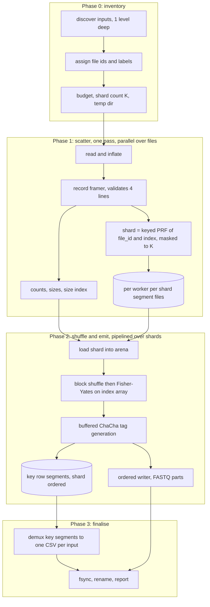

# Implementing ReadMixer in Rust

A complete design and implementation specification for rewriting ReadMixer (currently Python 3) as a
memory-bounded, cryptographically sound, high-throughput Rust program.

Target workload: directories of FASTQ files, individual inputs of **5-6 GB compressed** (`.fastq.gz`),
totalling up to terabytes. Design goals in priority order:

1. **Correctness** - the output must be a genuine uniform random permutation of the input reads, and the
   key files must allow exact reconstruction of the original mapping.
2. **Security** - no memory-unsafe code, no panics on hostile input, no plaintext or key material left
   behind, no path or resource abuse, minimal and audited dependency surface.
3. **Bounded resource use** - peak RSS governed by an enforced budget (default well under 2 GB) regardless
   of input size.
4. **Throughput** - end-to-end limited by decompression and disk bandwidth, not by the RNG, the shuffle,
   or allocator churn.

Two decisions were fixed before this document was written and are assumed throughout:

- **Shuffle scope: global.** The permutation spans every read of every input file, not just a chunk.
- **Compatibility: parity-plus.** File naming, header format, and the existing CSV columns are preserved so
  existing downstream parsers keep working, but correctness and security fixes are allowed and new CSV
  columns may be appended. This is called **format v2** below.

---

## Table of contents

1. [What ReadMixer does today](#1-what-readmixer-does-today)
2. [Defect inventory](#2-defect-inventory)
3. [Requirements for the Rust implementation](#3-requirements-for-the-rust-implementation)
4. [Architecture](#4-architecture)
5. [Bottleneck 1: random number generation](#5-bottleneck-1-random-number-generation)
6. [Bottleneck 2: shuffling reads](#6-bottleneck-2-shuffling-reads)
7. [I/O and compression](#7-io-and-compression)
8. [Security hardening](#8-security-hardening)
9. [Crate layout, dependencies, build profile](#9-crate-layout-dependencies-build-profile)
10. [CLI specification](#10-cli-specification)
11. [Output format specification (v2)](#11-output-format-specification-v2)
12. [Error handling and observability](#12-error-handling-and-observability)
13. [Test plan](#13-test-plan)
14. [Benchmark plan](#14-benchmark-plan)
15. [Implementation roadmap](#15-implementation-roadmap)
16. [Packaging and documentation](#16-packaging-and-documentation)
17. [Appendices](#17-appendices)

---

## 1. What ReadMixer does today

The whole program is four Python files: `readmixer.py` (argument parsing), `process/__init__.py` (re-export),
`process/scramble.py` (the pipeline, 625 lines), and `process/util.py` (RNG helpers and resource
heuristics, 279 lines). Everything below was read directly out of that code and is the behaviour the Rust
version must reproduce, except where section 2 marks it as a defect.

### 1.1 Conceptual purpose

FASTQ files carry a per-read header that identifies the instrument, run, lane, tile, coordinates, and often
the sample barcode. That header is identifying metadata. ReadMixer:

- replaces every read header with `@ReadMixerSecured <random DNA tag>`,
- pools reads from all input files into a single output stream and reorders them so that a read's position
  no longer reveals which sample or file it came from,
- writes a **key file** per input file that records, for every read, the original header, the original
  index, the new tag, and where the read landed in the output,
- optionally gzips everything.

The sequence, `+`, and quality lines are never altered. The key files are the sole means of undoing the
process, which makes them the most sensitive artifacts the tool produces.

### 1.2 CLI surface

```
python readmixer.py -s -p <input dir> [-o <output dir>] [-z] [-c N] [-w N] [-m GB] [-l LEVEL]
```

| Flag | Dest | Type | Default | Meaning |
|---|---|---|---|---|
| `-s`, `--scramble` | `scrambling` | bool | false | Required. Without it, prints a message plus `--help` and exits. |
| `-p`, `--pathname` | `pathname` | str | `os.getcwd()` | Input directory. |
| `-o`, `--output` | `output` | str | none (writes beside inputs / cwd) | Output directory, created with `makedirs(exist_ok=True)`. |
| `-z`, `-gz`, `-gzip`, `--zip` | `zipup` | bool | false | Gzip the outputs. |
| `-c`, `--chunk_size` | `chunk_size` | int | auto | Reads per chunk. |
| `-w`, `--workers` | `workers` | int | auto | Worker process count. |
| `-m`, `--max-ram` | `max_ram_gb` | float | auto | RAM ceiling in GB (advisory only). |
| `-l`, `--loglevel` | `loglevel` | choice | `error` | One of `info`, `debug`, `error`, `warning`, `critical`. Upper-cased and handed to `logging`. |

Both branches print `Process Completed.` at the end, including the failure branch.

### 1.3 Pipeline, step by step

**Step 1 - discovery** (`find_fastq_files`). A generator that yields, in this order:

1. `glob(<dir>/*.gz)`
2. `glob(<dir>/*.fastq)`
3. for each `glob(<dir>/*/)` subdirectory, in glob order: its `*.gz` then its `*.fastq`

Only one directory level deep. Note it matches **any** `.gz`, not just `.fastq.gz`.

**Step 2 - counting** (`count_reads_streaming`). For every discovered file it fully decompresses the file
just to count lines (`util.gzip_file_line_count` / `util.file_line_count`, both of which iterate every
line and discard it). Then:

- if `line_count % 4 != 0`, raise `ValueError` and abort the run;
- `read_count = line_count // 4`;
- files with zero reads are skipped entirely;
- append `(path, basename, read_count, running_total)` to `read_info`, so each file gets a **global start
  index** in discovery order;
- accumulate `os.path.getsize` into `estimated_input_size` (the *compressed* size).

**Step 3 - resource planning.** `util.ResourceManager` picks `chunk_size` and `num_workers`
(section 1.5), and `check_disk_space_requirements` may abort the run.

**Step 4 - session id.** `out_file_name = util.random_alphanumeric_string(40)`, 40 characters drawn from
`string.ascii_letters + string.digits` (62 symbols) using `Crypto.Random.random.choice`.

**Step 5 - chunk processing** (`process_reads_external_sort` -> `multiprocessing.Pool.map(process_chunk, ...)`).
The global read index space `[0, total_reads)` is cut into contiguous chunks of `chunk_size`. Each chunk
task receives `(chunk_idx, start_idx, end_idx, chunk_size_i, temp_dir, read_info, out_file_name)` and:

1. builds `perm = np.arange(chunk_size)` and calls `crypto_random.shuffle(perm.tolist())`;
2. opens `temp/chunk_<i>.fastq` for writing;
3. creates `temp/chunk_<i>_<basename>_key.csv` for **every** input file (not just the ones present in this
   chunk) and writes the header row
   `file_name,read_description,secure_index,original_index,tag,output_file_index`;
4. for each input file whose global range `[file_start, file_start+count)` intersects `[start_idx, end_idx)`:
   opens the file, advances the record iterator `file_read_start` times one record at a time, then reads
   `file_read_end - file_read_start` records, computing for each one
   `global_idx`, `read_desc = header without leading '@' and trailing newline`, and `tag = util.random_tag(7)`;
5. applies `reads_data = [reads_data[perm[i]] for i in range(len(reads_data))]`;
6. writes each record as `@ReadMixerSecured <tag>\n` followed by the original sequence, `+`, and quality
   lines **verbatim** (they still carry their original line terminators);
7. writes one key row per record: `[basename, compressed_desc, start_idx + n, orig_idx, tag, 0]`, where `n`
   counts from 0 within the chunk so `secure_index` is the read's global position in the merged output, and
   `compressed_desc` is `desc` if `len(desc) <= 100` else `desc[:50] + "..." + desc[-47:]`.

**Step 6 - merge and split** (`merge_chunk_files_with_splitting`). Chunk files are concatenated in chunk
index order into `<base>.partNNN.fastq` where `<base>` is the output path with the final `.fastq` stripped.
Records are re-parsed 4 lines at a time; a new part is started when
`current_file_size + len(record_bytes) > 5 GiB and current_file_size > 0`. It returns the list of parts and
`read_to_file_mapping: merged_read_index -> part_index`.

**Step 7 - key merge** (`update_key_files_with_output_mapping`). For each input basename, the per-chunk key
CSVs are concatenated in chunk order into `ReadMixerKeys.<session>.<basename>.csv` (header once), and column
6 (`output_file_index`) is rewritten from `read_to_file_mapping[secure_index]`.

**Step 8 - compression** (only with `-z`). Each key CSV and each FASTQ part is streamed through `gzip.open`
into `<name>.gz` with `shutil.copyfileobj` and the uncompressed original is deleted.

**Step 9 - cleanup** (`cleanup_temp_dir`). `subprocess.run(['rm', '-rf', temp_dir], timeout=300)`, falling
back to `shutil.rmtree`.

### 1.4 Random generation primitives (`process/util.py`)

```python
def int_to_base(base_int):        # 0->A, 1->C, 2->T, 3->G   (note: NOT the usual ACGT order)
def random_bases():               # secrets.randbits(16); uses bits 0..7 only; returns 4 base chars
def random_tag(n):                # concatenates n calls of random_bases() -> 4n bases
def random_alphanumeric_string(n) # n chars from [A-Za-z0-9] via Crypto.Random.random.choice
```

`random_tag(7)` is the only call site, giving **28 bases = 56 bits** per read. The base alphabet order
`A, C, T, G` is unusual and must be preserved for parity.

### 1.5 Resource heuristics (`process/util.py`)

- `SystemCapabilities`: `psutil.virtual_memory().total/.available`, `psutil.cpu_count()` physical and
  logical, `shutil.disk_usage(path).free` (falling back to a hardcoded 10 GB), and a `format_bytes` helper
  using 1024-based units with one decimal.
- `ResourceManager.max_ram_bytes`: `max_ram_gb * 2**30` if given, else
  `max(available - min(2 GiB, 0.2 * available), 1 GiB)`.
- `get_optimal_buffer_size()`: 8 MiB if budget >= 16 GiB, 4 MiB if >= 8 GiB, 2 MiB if >= 4 GiB, else 1 MiB.
- `get_optimal_processing_params(total_reads, estimated_read_size=400)`:
  `memory_per_read = 1200`, `usable = 0.8 * max_ram_bytes`; for `workers` in `1..=min(logical_cpus, 16)`,
  `chunk = clamp(usable / workers / 1200, 10_000, 5_000_000)`, skip if `chunk < 50_000`, score
  `workers * chunk * 0.9**(workers-1)`, keep the best. Followed by a rescale if the product still exceeds
  `usable`. Note that `total_reads` is only consulted in the degenerate fallback.
- `check_disk_space_requirements(input_size, path)`: requires
  `((input*3.2 + input*1.7) * 0.8 + (input*3.2 + input*1.7)) * 1.1`, i.e. **about 9.7x the compressed input
  size**, or it aborts.
- `monitor_memory_usage()`: warns above 90% system memory use (the README says 85%).

### 1.6 Test suite

`readmixer/tests/test_readmixer.py` contains 19 tests over a 10-read `tests/testing.fastq.gz`, grouped as
`TestFastqReading`, `TestDescriptionExtraction`, `TestRandomGeneration`, `TestIntToBase`,
`TestFileDiscovery`, `TestCountReads`, `TestResourceManager`, `TestIntegration`. Section 13 maps each one to
a Rust equivalent. The integration test asserts 40 output lines and that every 4th line starts with
`@ReadMixerSecured` - notably it does **not** assert that the order changed, which is why the defect in
section 2.1 went unnoticed.

---

## 2. Defect inventory

These are behaviours the Rust rewrite must **not** reproduce. Each is a concrete finding in the current
code, listed with its consequence and the required fix.

### 2.1 The reads are never shuffled (critical)

```python
perm = np.arange(chunk_size)
crypto_random.shuffle(perm.tolist())   # process/scramble.py
```

`ndarray.tolist()` returns a brand-new Python list. `shuffle` permutes that temporary in place and it is
immediately discarded, so `perm` remains `[0, 1, 2, ...]`. Step 5.5 then reduces to
`reads_data = reads_data[:]`, an identity mapping. **The tool currently emits reads in their original
order**; only the headers are replaced. Anyone holding the original files can re-identify every read by
positional alignment, which defeats the entire purpose of the tool.

Fix: a real, verified, global permutation (section 4 and 6), plus a test that asserts the output order
differs from the input order and a statistical uniformity test (section 13.3).

### 2.2 Chunk-local scope would still be weak even if 2.1 were fixed

Chunks are contiguous ranges of the global index space, so a working per-chunk shuffle would only permute
reads within a window. A read's output position would still identify its source file with near certainty
whenever files are larger than a chunk. Fix: global permutation across the whole dataset.

### 2.3 Quadratic decompression

`process_chunk` re-opens each overlapping input and advances the iterator `file_read_start` times, one
record at a time, to reach its starting offset. With `C` chunks over one file, the file is decompressed
`C` times and roughly `C^2/2` chunk-worth of records are decoded and thrown away, on top of the separate
full counting pass in step 2. For a 6 GB `.gz` (~21 GB of records) split into 20 chunks this is on the
order of 200 GB of wasted inflate work.

Fix: exactly one decompression pass over each input, ever (section 4.3).

### 2.4 Duplicate basenames silently collide and lose data

Everything is keyed by `os.path.basename`. Temp key files are named `chunk_<i>_<basename>_key.csv` and
`chunk_key_files_by_input` is a dict keyed by basename. Two inputs with the same basename in different
subdirectories - the normal case for per-sample directories such as `sampleA/R1.fastq.gz` and
`sampleB/R1.fastq.gz` - therefore share one temp path per chunk and one output key file. The second writer
truncates the first, so key rows are lost and the surviving key file conflates two samples.

Fix: identify inputs by a `u32` file id assigned at discovery; derive output key names from a collision-free
disambiguated label (section 11.3); abort with a clear error if a label still collides.

### 2.5 Tag collisions at realistic scale

28 bases is 56 bits, so the tag space is `4^28 = 2^56 ~= 7.2e16`. Expected collisions are `n^2 / 2^57`:

| Reads | Collision probability at 28 bases (56 bits) |
|---|---|
| 1e6 | 0.0007% |
| 1e7 | 0.07% |
| 1e8 | 6.7% |
| 5e8 | 82% |
| 1e9 | 99.9% |

A 6 GB `.fastq.gz` alone holds roughly 60-90 million reads, and the README advertises 1 TB datasets. A
duplicated tag makes the key file ambiguous: two reads map to the same identifier and neither can be
resolved. Nothing in the current code detects this.

Fix: default to 32 bases and offer a provably collision-free mode (section 5.5).

### 2.6 Entropy is drawn wastefully and slowly

`random_bases()` calls `secrets.randbits(16)` and then consumes only bits 0..7, discarding half of the
requested entropy. Each call is a trip to the OS CSPRNG. `random_tag(7)` makes 7 such calls per read, so a
100 million read dataset performs 700 million OS entropy requests and builds 8 intermediate Python strings
per read. Fix: section 5.

### 2.7 Temp file explosion

`process_chunk` creates a key CSV for *every* input file in *every* chunk, whether or not that chunk
contains any of that file's reads. With 100 chunks and 50 inputs that is 5,000 files, most of them a bare
header. Fix: section 4.5 emits one key segment per shard and demultiplexes once.

### 2.8 Unbounded memory and unrealistic disk requirement

`process_chunk` materialises `reads_data` as a Python list of tuples of `str` for the entire chunk. At the
auto-selected 5,000,000 reads per chunk with several workers, RSS reaches tens of gigabytes; the README
records ~50 GB in production. Separately, `check_disk_space_requirements` demands ~9.7x the compressed input
size and will refuse to run on machines that are actually fine. Fix: sections 4.10 and 7.5.

### 2.9 Key files are sensitive but not protected

Key CSVs de-anonymise the entire dataset. They are created with the process umask (commonly world-readable),
written before the FASTQ parts are durable, and never fsynced. Read descriptions are copied from untrusted
input into CSV cells with no guard against spreadsheet formula injection (a header beginning `=`, `+`, `-`,
`@`, tab, or CR becomes an executable formula in Excel/LibreOffice/Sheets). Fix: section 8.

### 2.10 Smaller issues to fix while rewriting

- `util.gzip_file_line_count` / `file_line_count` catch every exception, log one generic message, and call
  `exit()` from library code. They also reference `i` outside the loop, so an empty file raises
  `UnboundLocalError`, which is then swallowed into the same generic message and `exit()`.
- Output records copy the input's line terminators verbatim, so CRLF input produces CRLF output mixed with
  the LF-terminated synthetic header, and an input whose final record lacks a trailing newline corrupts the
  concatenation boundary in the merged part file.
- `row_counts` in `process_chunk` is built and never used.
- `merge_chunk_files_with_splitting` opens each chunk file twice (once `rb`, unused, once `r`) and rebuilds
  every record as a Python `str` then re-encodes it to UTF-8 just to measure its length.
- `read_to_file_mapping` is a dict with one entry per read - about 60-100 bytes per read, so gigabytes on
  large runs - when the same information is a handful of part boundaries.
- The `-z` path writes each output uncompressed, reads it back, compresses it, then deletes it: three passes
  where one would do.
- Compression failures are caught and logged but the run still reports success.
- The description truncation rule (`> 100` chars becomes `first 50 + "..." + last 47`) silently makes long
  headers unrecoverable, and is applied with no way to opt out.
- `original_index` is the *global* read index, not the index within the read's own file, which is surprising
  given that key files are per-file. v2 keeps the column and adds `original_index_in_file`.
- Files are decompressed with `encoding="utf-8"`, so a single invalid byte anywhere aborts the run;
  FASTQ is a byte format and should be handled as bytes.
- `Crypto.Random.random.shuffle` and `random.choice` are used in one module while `secrets` is used in
  another, for the same purpose.

---

## 3. Requirements for the Rust implementation

### 3.1 Functional

- F1. Accept the same CLI surface (section 10), with the same defaults and the same "no `-s`" behaviour.
- F2. Discover inputs with the same ordering and depth rules as `find_fastq_files`.
- F3. Validate FASTQ structure (records of exactly 4 lines) and reject malformed input with a message
  naming the file, the line number, and the reason.
- F4. Produce a **uniform random permutation** of the multiset of all reads from all inputs.
- F5. Rewrite every header as `@ReadMixerSecured <tag>` where `tag` is a DNA string over `A`, `C`, `T`, `G`.
- F6. Preserve the sequence, `+`, and quality lines byte-for-byte apart from line-terminator normalisation.
- F7. Split output into parts of at most a configurable size (default 5 GiB), named
  `ReadMixer.<session>.partNNN.fastq[.gz]`.
- F8. Emit one key CSV per input file named `ReadMixerKeys.<session>.<label>.csv[.gz]` with the v1 columns
  first, in output order.
- F9. Optionally gzip all outputs (`-z`), with no uncompressed intermediate left on disk.
- F10. Provide a `verify` subcommand that proves outputs and keys are mutually consistent with the inputs.
- F11. Remove all temporary state on success, on error, and on `SIGINT`/`SIGTERM`.

### 3.2 Security

- S1. `#![forbid(unsafe_code)]` in every crate.
- S2. No panic reachable from any input data. Malformed, truncated, hostile, or enormous input yields an
  `Err`, never an abort or an unwind through a partially written output.
- S3. All randomness from a cryptographically secure generator, seeded by the OS, with no bias in bounded
  sampling.
- S4. Integer overflow checked in release builds.
- S5. Sensitive artifacts (key files) created mode `0600`; the temp directory `0700`.
- S6. Temporary spill optionally encrypted with an ephemeral in-memory key.
- S7. Resource-exhaustion guards: max record size, max decompression ratio, max file count, enforced memory
  budget.
- S8. Path safety: canonicalisation, no symlink traversal by default, no output path escape, no overwrite of
  existing files.
- S9. Key material zeroized on drop; core dumps disabled.
- S10. Reproducible builds from a committed `Cargo.lock`, `cargo-deny` and `cargo-audit` clean, CycloneDX
  SBOM regenerated on release.

### 3.3 Performance

For a single 6 GB `.fastq.gz` on 8 cores with NVMe storage. Assuming the shape of the repository's own test
data (90 bp reads, ~50-character headers, so roughly 280 bytes per record) and a 3.5x compression ratio, that
is about 21 GB of records and 75 million reads:

| Metric | Python today | Rust target |
|---|---|---|
| Wall clock | ~5.2 min at the README's 1.15 GB/min | <= 90 s |
| Peak RSS | tens of GB (README: ~50 GB) | <= 2 GB, enforced |
| Decompression passes over each input | 1 + one per overlapping chunk | exactly 1 |
| Peak temp disk | ~7.8x compressed input | <= 1.5x compressed input with LZ4 temp |
| Tag generation | ~7 OS entropy calls per read | >= 50 M tags/s/core from a buffered CSPRNG |
| Shuffle | none (defect 2.1) | >= 150 M index swaps/s, cache-aware |

---

## 4. Architecture

### 4.1 Overview

The design is a **two-phase random-bucket external shuffle**. Phase 1 makes a single streaming pass over
the inputs and scatters each record to a randomly chosen shard on disk. Phase 2 loads one shard at a time,
shuffles it entirely in memory, generates tags, and emits output. Concatenating the shards in shard order
yields a uniform permutation of the whole dataset (proof in section 4.7) using only sequential I/O.



Total I/O: one read of each input, one write plus one read of the temp shards, one write of the output.
That is the theoretical minimum for an external shuffle that cannot random-access a gzip stream.

### 4.2 Phase 0: inventory and planning

```rust
pub struct InputFile {
    pub id: u32,               // dense, assigned in discovery order
    pub path: PathBuf,         // canonicalised
    pub label: String,         // sanitised, collision-free name used in key file names
    pub basename: String,      // os.path.basename equivalent, for the CSV file_name column
    pub compressed_len: u64,
    pub codec: Codec,          // Plain | Gzip | Bgzf
}
```

Discovery reproduces `find_fastq_files` exactly: `*.gz` then `*.fastq` in the root, then for each
subdirectory in sorted order its `*.gz` then `*.fastq`. Glob ordering in Python is filesystem order, which
is not stable; the Rust version **sorts** each group so that discovery order, and hence `file_id`,
`original_index`, and label assignment, are deterministic. This is a deliberate v2 improvement.

Labels: start from the basename, replace any byte outside `[A-Za-z0-9._-]` with `_`, strip leading `.` and
`-`, and if two inputs still produce the same label, prefix with the parent directory name, then with an
ordinal, until unique. The `file_name` CSV column keeps the raw basename for parity; the label only affects
the key file's own name.

Read counts are **not** computed here. Unlike the Python version there is no counting pass; totals emerge
from Phase 1. The pre-flight disk check therefore works from compressed sizes and a configurable expansion
estimate, and is re-checked with real numbers once Phase 1 finishes (section 7.5).

Shard count `K` is chosen so that one shard's payload fits comfortably in the per-worker share of the
memory budget:

```rust
// target_shard_bytes = the arena size we are willing to hold per in-flight shard
let est_records_bytes = total_compressed as f64 * cfg.expansion_estimate; // default 3.5
let target = (budget.arena_bytes_per_inflight_shard()) as f64;
let k = (est_records_bytes / target).ceil().max(1.0) as usize;
let k = k.next_power_of_two().clamp(cfg.min_shards /*8*/, cfg.max_shards /*256*/);
```

`K` is capped at 256 because Phase 1 keeps `workers * K` segment writers open; anything larger is handled by
recursive sub-sharding in Phase 2 instead (section 6.4). The file-descriptor budget is checked up front
against `RLIMIT_NOFILE` and the run aborts with actionable advice rather than failing mid-pass.

### 4.3 Phase 1: scatter

One task per input file, run on a `rayon` pool sized to `--threads`. Per task:

```
open -> BufReader(1-8 MiB) -> decoder (plain | flate2/zlib-ng | bgzf) -> RecordFramer -> ShardScatter
```

The framer works on bytes, never `String`. It refills a reusable buffer and locates four `\n`-terminated
lines per record, normalising each line by stripping a trailing `\r\n` or `\n`:

```rust
pub struct Record<'a> {
    pub desc: &'a [u8],   // header without the leading '@' and without the terminator
    pub seq:  &'a [u8],
    pub plus: &'a [u8],   // kept because it may repeat the description
    pub qual: &'a [u8],
}
```

Validation performed inline, each producing a precise error: header must start with `@`; the third line must
start with `+`; `seq.len() == qual.len()`; a record must not exceed `--max-record-bytes` (default 1 MiB);
the file must end on a record boundary (a trailing partial record is an error, matching the spirit of the
`% 4 != 0` check but with a far better message).

Shard assignment uses a **keyed PRF of the record's identity**, not a sequential RNG stream:

```rust
#[inline]
fn shard_of(prf: &ShardPrf, file_id: u32, index_in_file: u64, k_mask: u64) -> usize {
    // SipHash-1-3 keyed with a per-run 128-bit key
    (prf.hash(file_id, index_in_file) & k_mask) as usize
}
```

Why a PRF and not `rng.gen_range(0..K)`: it makes the assignment independent of thread scheduling, which
makes the whole run reproducible under a fixed key and makes Phase 2's optional size-planning pass able to
recompute assignments without storing them. A keyed SipHash output masked to a power-of-two `K` is uniform
and unbiased, and is not distinguishable from random without the key. `K` is always a power of two so the
mask is exact and no modulo bias exists.

Each worker owns its own set of `K` segment writers, so no locking occurs on the hot path:

```
<temp>/s<shard:03}/w<worker:02}.seg
```

Shard `j`'s logical content is the concatenation of `w00.seg`, `w01.seg`, ... in worker index order, which is
deterministic. Each writer holds a small buffer (default 256 KiB, so `workers * K * 256 KiB` of buffer RAM,
counted against the budget) and appends length-prefixed frames.

Alongside the data, each worker appends to `<temp>/s<shard>/w<worker>.sizes` a `u32` per record giving the
record's **output** byte length. This 4-bytes-per-read side index is what makes the optional positional-write
fast path possible (section 4.6) and costs ~300 MB for a 75 M read dataset, or nothing at all if that path is
disabled.

Phase 1 returns:

```rust
pub struct ScatterReport {
    pub per_file: Vec<FileStats>,        // read_count, payload_bytes, max_record_len
    pub per_shard: Vec<ShardStats>,      // record_count, payload_bytes, output_bytes
    pub total_reads: u64,
    pub total_output_bytes: u64,
}
```

Because `total_output_bytes` and every shard's `record_count` are now known exactly, each shard's
`secure_index` base is a simple prefix sum, and the final disk requirement is known before any output byte
is written.

### 4.4 Shard frame format

Fixed 28-byte header, little-endian, followed by two variable byte runs. The three preserved lines are
stored as one contiguous blob so that Phase 2 emits them with a single `extend_from_slice`.

| Offset | Size | Field | Notes |
|---|---|---|---|
| 0 | 4 | `frame_len` | total frame length including this header; bounds the read |
| 4 | 4 | `file_id` | index into the `InputFile` table |
| 8 | 8 | `index_in_file` | 0-based record ordinal within its own file |
| 16 | 4 | `desc_len` | length of the description bytes |
| 20 | 4 | `seq_len` | `u32`, since `--max-record-bytes` defaults to 1 MiB |
| 24 | 4 | `plus_len` | `u32`, same reason |
| 28 | `desc_len` | `desc` | header without `@` and without the terminator |
| .. | `blob_len` | `seq \n plus \n qual \n` | written verbatim to the output |

All fields are written and read with explicit `to_le_bytes`/`from_le_bytes` against a byte slice, never by
transmuting or casting a struct, so there is no unsafe code and no dependence on alignment, padding, or the
host's endianness. The authoritative definition is the encoder/decoder pair in `shard.rs`, which is
round-trip property tested and fuzzed.

`qual_len` is not stored: it is `blob_len - seq_len - plus_len - 3`. The decoder validates that every derived
length is consistent and that `frame_len` matches, and returns `Err(ShardCorrupt)` otherwise. Temp files are
ours, but treating them as untrusted costs nothing and turns a bit-flip into a clean error instead of a
panic or a silent mis-parse.

`original_index` (the global value the v1 CSV expects) is derived, not stored:
`file_start_index[file_id] + index_in_file`, where `file_start_index` is the prefix sum of read counts in
discovery order, available after Phase 1.

### 4.5 Phase 2: shuffle and emit

Shards are processed **in shard order** for output purposes, but the expensive per-shard work runs in
parallel with a bounded lookahead. A `crossbeam-channel` pipeline with a reorder buffer gives determinism
and backpressure:

```
K shard ids -> [ N worker threads: load, shuffle, tag, render ] -> reorder buffer -> 1 writer thread
```

Bounded channels are the memory-budget enforcement mechanism: at most `lookahead` rendered shards exist at
once, and `lookahead` is derived from the budget, so the pipeline blocks rather than growing.

Per shard, a worker:

1. **Loads** the shard's segment files in worker order into one `arena: Vec<u8>` (capacity reserved from
   `ShardStats::payload_bytes`, so no reallocation), building `slots: Vec<Slot>` where
   `Slot { off: u32, len: u32 }` points into the arena. If the shard exceeds the arena budget, it is
   recursively sub-sharded (section 6.4).
2. **Shuffles** `slots` (section 6). Only 8 bytes per record move.
3. **Renders** into an output buffer: for each slot in shuffled order, generate a tag, write
   `@ReadMixerSecured <tag>\n`, then `extend_from_slice(blob)`. In the same loop it appends a key row to a
   per-file `Vec<u8>` staging buffer.
4. Hands `(shard_id, fastq_bytes, key_rows_by_file)` to the reorder buffer.

The writer thread consumes shards in ascending id, appends to the current part file, and applies the
part-splitting rule per record exactly as `merge_chunk_files_with_splitting` does. Since the writer sees
records in final order it can also assign `output_file_index` on the spot - no post-hoc backfill, no
`read_to_file_mapping` dict.

To keep `output_file_index` correct without a second pass, the key row is emitted with a placeholder that
the writer patches: the renderer writes the row with a fixed-width, zero-padded part field
(`%03u`), and records the byte offset of that field. The writer overwrites those three bytes in the staging
buffer as it decides each record's part. This is O(1) per record and keeps rows in output order.

### 4.6 Optional positional-write fast path

Default operation uses the single ordered writer above, which is optimal when output is gzipped (compression
dominates) and near-optimal otherwise. For uncompressed output on fast NVMe or parallel filesystems,
`--positional-writes` enables a plan-then-write scheme that removes the serialisation point:

1. **Plan pass.** Walk shards in order. For each, read only `w*.sizes` (4 bytes per record, not the payload),
   recompute the shard's permutation from its deterministic seed, and apply the greedy part-splitting rule to
   the ordered size sequence. Store only the part boundaries and each shard's `(part_index, byte_offset,
   secure_index_base)` - `O(K + parts)` memory, a few kilobytes.
2. **Preallocate** each part with `File::set_len` (plus `fallocate` where available).
3. **Write pass.** All shards proceed fully in parallel, writing with `FileExt::write_all_at` at their
   precomputed offsets. `write_all_at` is safe stable std (`std::os::unix::fs`, with
   `seek_write` on Windows), so no unsafe code is required.

The plan pass costs one sequential read of the size index and a repeat of the (cheap) shuffle. It is only
worth it when the writer is measurably the bottleneck, which is why it is opt-in and covered by the same
invariant tests as the default path.

### 4.7 Why this produces a uniform permutation

Claim: let `n` records be assigned independently and uniformly at random to `K` shards, let each shard be
independently and uniformly permuted, and let the output be the concatenation of shards in shard order.
Then every one of the `n!` orderings occurs with probability exactly `1/n!`.

Proof: condition on the shard sizes `(n_1, ..., n_K)`, `sum n_j = n`. Given those sizes, the assignment is a
uniformly random ordered partition of the `n` records into blocks of those sizes, of which there are the
multinomial `n! / (n_1! ... n_K!)`. Given the partition, each block is independently uniformly permuted,
contributing `prod_j 1/n_j!`. Any target ordering is consistent with any size vector - just cut the ordering
at the block boundaries - and corresponds to exactly one partition/permutation pair. Hence

```
P(ordering | sizes) = (n_1! ... n_K! / n!) * prod_j (1 / n_j!) = 1 / n!
```

which is independent of the sizes, so summing over the size distribution gives `1/n!` unconditionally. QED.

Three practical consequences the implementation must respect:

- **Shard sizes must be left alone.** Any attempt to rebalance, cap, or reject oversized shards breaks the
  independence of the assignment and destroys uniformity. Oversized shards are handled by *recursive
  sub-sharding*, which is the same construction applied to the shard's own element set and therefore
  preserves uniformity.
- **Assignment must be uniform over `K` and independent per record.** A power-of-two `K` with a masked
  keyed-PRF output satisfies both; a modulo of a non-power-of-two would introduce bias.
- **The within-shard permutation must itself be uniform**, which is what section 6 is about. The two-level
  block shuffle used inside a shard is the same construction again, so it composes without loss.

### 4.8 In-memory fast path

If the estimated record payload fits the budget - common for a single 5-6 GB `.fastq.gz` on a 64 GB
workstation - the temp-file round trip is pure overhead. When
`estimated_payload_bytes <= budget.in_memory_bytes` the pipeline collapses to:

```
inflate -> frame -> append to one arena + slots (parallel per file, then merge slot vectors)
        -> global block shuffle -> tag + render -> write
```

One read, one write, no temp files. Selection is automatic, forced on with `--in-memory`, forced off with
`--external`. The estimate is checked as it goes: if the arena is about to exceed the budget the run
transparently degrades to the external path by scattering what it has (the arena's records are re-emitted
through the normal PRF assignment), so a bad expansion estimate never becomes an OOM.

### 4.9 Determinism model

Everything derives from a single 256-bit **run key**, drawn from the OS by default:

```
run_key = getrandom(32)                       (or KDF(--seed) under the insecure-testing feature)
shard_prf_key   = KDF(run_key, "readmixer/v2/shard-prf")
session_id_key  = KDF(run_key, "readmixer/v2/session-id")
tag_key         = KDF(run_key, "readmixer/v2/tag")
shuffle_key     = KDF(run_key, "readmixer/v2/shuffle")
per_shard_seed(j) = KDF(shuffle_key, j.to_le_bytes())
temp_enc_key    = KDF(run_key, "readmixer/v2/temp-aead")
```

`KDF` is HKDF-SHA256 (or BLAKE3's `derive_key`, which is a single dependency and faster). Per-shard seeds are
what let the positional-write plan pass recompute a permutation without storing it, and what make the whole
run reproducible for debugging. The run key lives in a `Zeroizing<[u8; 32]>` and is never written to disk or
logged.

### 4.10 Memory model

Nothing in the design scales with `total_reads` except things that are explicitly budgeted:

| Allocation | Size | Bounded by |
|---|---|---|
| Input decode buffers | `threads * buffer_size` | `--threads`, 1-8 MiB each |
| Phase 1 segment write buffers | `threads * K * 256 KiB` | `K <= 256`, buffer size scaled down if needed |
| Phase 2 shard arena | `payload_bytes(shard)` | `K` chosen so this fits; recursive sub-sharding as backstop |
| Phase 2 slot vector | `8 bytes * records(shard)` | same |
| Phase 2 rendered output buffer | `output_bytes(shard)` | same |
| In-flight shards | `lookahead * (arena + render)` | bounded channel depth from the budget |
| Key row staging | `~150 bytes * records(shard)` | per shard, released after the writer consumes it |
| Part boundary table | `24 bytes * parts` | trivial |

The budget itself comes from `min(--max-ram, cgroup limit, available RAM heuristic)` - see section 8.9 for
why the cgroup limit matters and `psutil` misses it. A `MemoryBudget` type hands out reservations, and every
large allocation goes through `Vec::try_reserve` so that exhaustion is a clean error rather than an abort.

---
## 5. Bottleneck 1: random number generation

### 5.1 Why the Python version is slow here

Per read, `random_tag(7)` performs:

- 7 calls to `secrets.randbits(16)`, each of which reads from the OS CSPRNG (`/dev/urandom` or `getrandom`)
  through Python's `SystemRandom`, discarding 8 of the 16 bits it asked for;
- 28 calls to `int_to_base`, a Python function with a 4-branch `if/elif` chain, each returning an interned
  1-character `str`;
- 28 `str` concatenations building 4-character groups, then 7 more building the 28-character tag - every one
  allocating a new immutable `str`.

That is roughly 40 Python-level function calls and 35 allocations per read, plus 7 kernel round trips. At
75 million reads it is 525 million entropy requests and about 2.6 billion allocations. On a typical machine
this alone accounts for minutes of CPU time and is a large share of total runtime.

### 5.2 The design: one buffered stream cipher per worker

Cryptographic security does not require asking the kernel for every byte. It requires a
cryptographically strong generator seeded from a strong source. So: seed a ChaCha stream once per worker
thread from the OS, then generate randomness in bulk into a reusable buffer and hand out slices.

```rust
use chacha20::{ChaCha12, cipher::{KeyIvInit, StreamCipher}};
use zeroize::Zeroize;

const BUF_LEN: usize = 64 * 1024;          // fits comfortably in L2
const RESEED_AFTER_BYTES: u64 = 1 << 32;   // 4 GiB per stream, then rekey

pub struct CsprngBuf {
    cipher: ChaCha12,
    buf: Box<[u8; BUF_LEN]>,
    pos: usize,
    produced: u64,
}

impl CsprngBuf {
    pub fn from_key(key: &[u8; 32], nonce: &[u8; 12]) -> Self { /* ... */ }

    #[inline]
    fn refill(&mut self) {
        self.buf.fill(0);
        self.cipher.apply_keystream(&mut self.buf[..]);   // keystream == random bytes
        self.pos = 0;
        self.produced += BUF_LEN as u64;
        if self.produced >= RESEED_AFTER_BYTES { self.rekey_from_own_output(); }
    }

    #[inline]
    pub fn bytes(&mut self, n: usize) -> &[u8] {
        debug_assert!(n <= BUF_LEN);
        if self.pos + n > BUF_LEN { self.refill(); }
        let s = &self.buf[self.pos..self.pos + n];
        self.pos += n;
        s
    }

    #[inline]
    pub fn next_u64(&mut self) -> u64 {
        u64::from_le_bytes(self.bytes(8).try_into().unwrap())
    }
}

impl Drop for CsprngBuf {
    fn drop(&mut self) { self.buf.zeroize(); }
}
```

Notes that matter:

- **ChaCha12, not ChaCha20.** ChaCha12 has a very large security margin (the best attacks reach 7 rounds)
  and is about 1.6x faster. `rand`'s own `StdRng` was ChaCha12 for exactly this reason. Multi-GB/s per core
  with AVX2.
- **Use the RustCrypto `chacha20` crate for the bulk buffer**, not `rand_chacha`. `rand_chacha` sits on
  `ppv-lite86`, whose AVX2 backend is selected at *compile* time via `target-feature`, so a portable
  `x86-64` build silently gets the scalar path. `chacha20` uses `cpufeatures` for *runtime* detection, so a
  single portable binary still gets AVX2 where the CPU has it. This is worth a 2-4x difference on the
  hot path.
- Rekeying from the generator's own output every 4 GiB gives forward secrecy: an attacker who recovers the
  state cannot roll it backwards.
- The buffer is zeroized on drop, and `BUF_LEN` is sized so the refill stays in L2 and never touches the
  allocator after construction.

Per-worker nonces are derived from `(tag_key, worker_id, purpose)` so streams never overlap, which is a
correctness requirement for a stream cipher: reusing a key/nonce pair across workers would produce
*identical* random output in two workers.

### 5.3 Tag encoding with a 256-entry table

The tag is a base-4 string. Each random byte encodes exactly 4 bases, so precompute the entire mapping:

```rust
/// Preserves the existing ReadMixer alphabet order: 0->A, 1->C, 2->T, 3->G.
const BASES: [u8; 4] = [b'A', b'C', b'T', b'G'];

/// BYTE_TO_BASES[b] = the 4 bases encoded by b, low 2 bits first (matching random_bases()).
static BYTE_TO_BASES: [[u8; 4]; 256] = build_table();

const fn build_table() -> [[u8; 4]; 256] {
    let mut t = [[0u8; 4]; 256];
    let mut b = 0usize;
    while b < 256 {
        t[b] = [
            BASES[(b >> 0) & 0b11],
            BASES[(b >> 2) & 0b11],
            BASES[(b >> 4) & 0b11],
            BASES[(b >> 6) & 0b11],
        ];
        b += 1;
    }
    t
}

/// Appends `bases` DNA characters to `out`. `bases` must be a multiple of 4.
#[inline]
pub fn push_tag(out: &mut Vec<u8>, rng: &mut CsprngBuf, bases: usize) {
    debug_assert_eq!(bases % 4, 0);
    let src = rng.bytes(bases / 4);
    for &b in src {
        out.extend_from_slice(&BYTE_TO_BASES[b as usize]);
    }
}
```

Cost for a 32-base tag: 8 random bytes and 8 four-byte appends into a buffer that already has capacity. The
`extend_from_slice(&[u8; 4])` lowers to a single 4-byte store. There is no allocation, no branch on the base
value, and no `String`. The whole tag costs a handful of nanoseconds, which is why the target in section 3.3
is 50 M tags/s/core and why real measurements should land well above it.

The table is `const`-built at compile time, so it is a 1 KiB read-only blob in `.rodata` that stays resident
in L1 for the entire run.

Building the header in the same breath, with the constant prefix as a slice so the length is exact:

```rust
const HDR: &[u8] = b"@ReadMixerSecured ";

#[inline]
fn render_record(out: &mut Vec<u8>, rng: &mut CsprngBuf, tag_bases: usize, blob: &[u8]) -> Range<usize> {
    out.extend_from_slice(HDR);
    let tag_start = out.len();
    push_tag(out, rng, tag_bases);
    let tag_range = tag_start..out.len();
    out.push(b'\n');
    out.extend_from_slice(blob);   // seq \n plus \n qual \n, already normalised
    tag_range
}
```

The output size of a record is therefore exactly `HDR.len() + tag_bases + 1 + blob.len()` =
`19 + tag_bases + blob.len()`, known without rendering it, which is what makes the size index in section 4.3
and the plan pass in section 4.6 possible.

### 5.4 Unbiased bounded sampling

Fisher-Yates needs a uniform integer in `[0, i]`. `x % (i+1)` is biased, and the textbook rejection loop
costs a division per draw. Use Lemire's nearly-divisionless method, which needs one 64x64 multiply in the
common case and a division only in the rare rejection branch:

```rust
/// Uniform in [0, s) for s > 0, with no modulo bias.
#[inline]
pub fn bounded(rng: &mut CsprngBuf, s: u64) -> u64 {
    let mut x = rng.next_u64();
    let mut m = (x as u128) * (s as u128);
    let mut l = m as u64;                       // low 64 bits
    if l < s {
        let t = (u64::MAX - s + 1) % s;         // 2^64 mod s, computed once per rejection
        while l < t {
            x = rng.next_u64();
            m = (x as u128) * (s as u128);
            l = m as u64;
        }
    }
    (m >> 64) as u64
}
```

The rejection probability is at most `s / 2^64`, so for any plausible `s` the loop body effectively never
runs and the `%` is never executed. On x86-64 the `u128` multiply is a single `mulx`.

For the shard assignment the code avoids bounded sampling entirely by keeping `K` a power of two and masking,
which is exactly uniform by construction.

`rand`'s `Rng::gen_range` already implements a variant of this, so using `rand` is not wrong - the reason to
hand-roll is to draw from the same buffered ChaCha stream as everything else rather than paying for a second
generator and its trait indirection in the innermost loop.

### 5.5 Tag length and guaranteed uniqueness

Two independent problems: how long should a random tag be, and can collisions be eliminated outright.

**Random tags, sized properly.** With `n` reads and a `b`-base tag the expected number of colliding pairs is
`n^2 / 2^(2b+1)`:

| Tag bases | Bits | Space | P(collision) at 1e8 reads | at 1e9 reads |
|---|---|---|---|---|
| 28 (v1 default) | 56 | 7.2e16 | 6.7% | 99.9% |
| 32 (v2 default) | 64 | 1.8e19 | 0.027% | 2.7% |
| 36 | 72 | 4.7e21 | 0.0001% | 0.011% |
| 40 | 80 | 1.2e24 | negligible | 0.00004% |

v2 defaults to **32 bases** (a clean 8 random bytes, one table lookup per byte) and exposes
`--tag-bases <multiple of 4>` with a startup warning when the chosen length gives a collision probability
above 1e-6 for the observed read count. Since the read count is only known after Phase 1 and tags are
generated in Phase 2, this warning is emitted with real numbers, not an estimate.

**Provably collision-free tags.** With `--tag-mode prp`, the tag is not random but a keyed pseudo-random
*permutation* of the read's `secure_index`. A bijection cannot collide, so the collision question disappears
entirely, and without the key the output is indistinguishable from random.

Implementation: a balanced Feistel network on `2b` bits (two halves of `b` bits each), with a keyed
round function. Eight rounds is a comfortable margin over the four that Luby-Rackoff requires, and each round
is one short hash:

```rust
pub struct TagPrp { key: [u8; 32], half_bits: u32, rounds: u32 }

impl TagPrp {
    #[inline]
    fn round(&self, r: u32, x: u64) -> u64 {
        // BLAKE3 keyed hash or SipHash-1-3; 8 bytes of output masked to half_bits
        let h = self.hash(r, x);
        h & ((1u64 << self.half_bits) - 1)
    }

    /// Bijective on [0, 2^(2*half_bits)).
    pub fn encrypt(&self, index: u64) -> u64 {
        let mask = (1u64 << self.half_bits) - 1;
        let (mut l, mut r) = (index >> self.half_bits, index & mask);
        for i in 0..self.rounds {
            let t = l ^ self.round(i, r);
            l = r;
            r = t;
        }
        (l << self.half_bits) | r
    }
}
```

`--tag-bases 32` gives a 64-bit domain, exactly `2^64`, so no cycle-walking is needed. For a tag length whose
domain is smaller than the index space the run aborts at startup with a clear message
(`--tag-bases 32` supports up to `1.8e19` reads, which is not a practical limit). The 64-bit result is then
rendered with the same `BYTE_TO_BASES` table, so rendering cost is identical to the random path.

Security notes for `prp` mode, to be stated in the user documentation:

- The PRP key is derived from the per-run key and is **never persisted**. Reusing a key across runs would
  make identical output positions produce identical tags, correlating separate datasets. A fresh run key per
  invocation prevents this.
- Knowing the key lets one map tag <-> `secure_index`. That is not a new leak, because the key CSV already
  publishes exactly that mapping; it is simply another reason the key file and the run key are the sensitive
  material.
- Random mode remains the default because it needs no such caveats. `prp` is for datasets large enough that
  collision-freedom is worth the extra explanation.

### 5.6 Session id

`random_alphanumeric_string(40)` becomes a single unbiased draw over the 62-character alphabet. Rejection
sampling avoids the modulo bias that a naive `byte % 62` would introduce (62 does not divide 256, so the
first 8 characters would be ~1.6% more likely):

```rust
const ALPHANUM: &[u8; 62] = b"ABCDEFGHIJKLMNOPQRSTUVWXYZabcdefghijklmnopqrstuvwxyz0123456789";

pub fn session_id(rng: &mut CsprngBuf, len: usize) -> String {
    let mut s = String::with_capacity(len);
    while s.len() < len {
        for &b in rng.bytes(64) {
            if s.len() == len { break; }
            let v = b & 0x3F;              // 0..=63
            if v < 62 { s.push(ALPHANUM[v as usize] as char); }   // reject 62, 63
        }
    }
    s
}
```

40 characters from a 62-symbol alphabet is ~238 bits, far more than needed to make output names
unguessable; the length is kept at 40 for parity. `rand::distr::Alphanumeric` is an acceptable alternative
and is also unbiased.

### 5.7 Deterministic mode, safely gated

Reproducible runs are essential for testing a shuffle, and dangerous in production. The `--seed` flag is
therefore compiled out unless the crate is built with the `insecure-testing` feature:

```rust
#[cfg(feature = "insecure-testing")]
#[arg(long, hide = true, value_name = "HEX32")]
pub seed: Option<String>,
```

```toml
[features]
default = []
insecure-testing = []     # never enabled for released binaries
```

When present it replaces `getrandom` with `KDF(seed)` for the run key of section 4.9 and prints a prominent
warning on both stderr and into the run manifest. CI builds the release artifacts without the feature, and a
test asserts that `--seed` is rejected by a default-feature build. This gives fully reproducible tests with
no possibility of a predictable permutation escaping into a real deployment.

### 5.8 Expected effect

| Operation | Python | Rust |
|---|---|---|
| Random bytes for one 32-base tag | 7 OS calls, 14 bytes requested, 7 used | 8 bytes from an L2-resident buffer |
| Tag rendering | ~35 allocations, ~40 interpreter calls | 8 four-byte stores into a reserved buffer |
| Bounded integer draw | `Crypto.Random` object churn | one `mulx`, no division |
| Tags per second per core | order of 1e5 | order of 1e8 |

The RNG stops being a bottleneck entirely: at 75 million reads, 32-base tags need 600 MB of keystream, which
ChaCha12 produces in well under a second on one core.

---

## 6. Bottleneck 2: shuffling reads

### 6.1 The three costs of a shuffle, and which one matters

A shuffle of `n` records has three separable costs:

1. **Randomness** - `n` bounded draws. Solved in section 5; effectively free.
2. **Moving the records** - if records are moved, `O(total bytes)` of random-access copying. This is the
   cost the Python version would pay (it rebuilds a list of tuples of `str`).
3. **Memory latency** - Fisher-Yates touches `a[j]` for a random `j` each step. Once the array exceeds L2,
   nearly every step is a cache miss and, past L3, a TLB miss too. This is the real limit for large `n` and
   the one most implementations ignore.

The design attacks all three: never move payloads, keep the shuffled array tiny, and restructure the access
pattern so it is sequential.

### 6.2 Shuffle an index array, never the payload

Phase 2 holds a shard as one contiguous arena plus a slot table:

```rust
#[derive(Clone, Copy)]
pub struct Slot { pub off: u32, pub len: u32 }   // exactly 8 bytes

pub struct ShardData {
    arena: Vec<u8>,          // all frames back to back, capacity reserved exactly
    slots: Vec<Slot>,        // one 8-byte entry per record
}
```

Consequences:

- The shuffled working set is `8 * records`, not `~280 * records`. A 4 M record shard shuffles 32 MB instead
  of 1.1 GB - a 35x reduction in the bytes that must be randomly accessed.
- `Slot` is `Copy` and 8 bytes, so a swap is two 8-byte moves with no bounds-check overhead inside the loop
  when written against a slice.
- The arena is read **sequentially at render time in shuffled order**, which is random access into the arena
  - but that is a single streaming copy per record with hardware prefetch friendliness inside each record,
  and it is unavoidable in any shuffle. Crucially it happens once, not `log n` times.
- `u32` offsets cap a shard's arena at 4 GiB, which is far above any sane arena budget; the loader asserts it
  and sub-shards if needed.

### 6.3 Cache-aware two-level shuffle inside a shard

Plain Fisher-Yates on a 32 MB slot array is memory-latency bound. Replace it with the same
scatter-then-shuffle construction used at the shard level, sized to the cache:

```rust
/// Uniform random permutation of `slots`, with a sequential-write scatter pass
/// followed by cache-resident Fisher-Yates passes.
pub fn block_shuffle(slots: &mut Vec<Slot>, rng: &mut CsprngBuf, l2_slots: usize) {
    let n = slots.len();
    if n <= l2_slots { fisher_yates(slots, rng); return; }

    // Number of buckets, power of two so assignment is a mask (exactly uniform).
    let buckets = (n / l2_slots).next_power_of_two().max(2);
    let mask = (buckets - 1) as u64;

    // Pass 1: scatter into per-bucket Vecs. Writes are sequential per bucket.
    let mut bins: Vec<Vec<Slot>> = (0..buckets)
        .map(|_| Vec::with_capacity(n / buckets + n / (buckets * 8) + 16))
        .collect();
    for &s in slots.iter() {
        let b = (rng.next_u64() & mask) as usize;
        bins[b].push(s);
    }

    // Pass 2: each bin now fits in cache; shuffle in place, then concatenate in bin order.
    slots.clear();
    for bin in bins.iter_mut() {
        if bin.len() > l2_slots { block_shuffle(bin, rng, l2_slots); }   // rare, keeps uniformity
        else { fisher_yates(bin, rng); }
        slots.extend_from_slice(bin);
    }
}

#[inline]
fn fisher_yates(a: &mut [Slot], rng: &mut CsprngBuf) {
    for i in (1..a.len()).rev() {
        let j = bounded(rng, (i + 1) as u64) as usize;
        a.swap(i, j);
    }
}
```

Why this is fast: pass 1 is a sequential read of `slots` and `buckets` sequential append streams. Modern
cores sustain many concurrent write streams as long as the count stays below the number of L1 fill buffers
and store-buffer capacity, so `buckets` should be kept modest (64-512 is the useful range; if `n / l2_slots`
demands more, recurse instead of widening). Pass 2 does all the random access inside a working set chosen to
fit L2, where a "miss" costs a few nanoseconds instead of a few hundred.

Uniformity is preserved by exactly the argument in section 4.7, applied at bucket granularity: independent
uniform bucket assignment plus uniform within-bucket permutation plus concatenation in bucket order gives a
uniform permutation of the shard. The construction composes at all three levels (shards, buckets, recursive
sub-buckets) without any loss, which is the reason to use the same primitive throughout rather than mixing
schemes.

Tuning: `l2_slots` is derived from the detected L2 size (via `raw-cpuid`/`sysconf`, defaulting to 512 KiB),
halved for safety, divided by 8 bytes - so roughly 32,768 slots. It is overridable with a hidden
`--shuffle-block-slots` flag for benchmarking. The benchmark in section 14.2 measures plain Fisher-Yates
against `block_shuffle` across `n` from 1e4 to 1e9 so the crossover is documented rather than assumed.

An additional micro-optimisation worth benchmarking but not worth complicating the code for by default:
pre-generating the whole `bounded` sequence for a bin into a scratch `Vec<u32>` before the swap loop, which
decouples RNG latency from the dependent swap chain. Expect a modest gain; include it behind a bench, adopt
only if measured.

### 6.4 Shard sizing and recursive sub-sharding

`K` is chosen in Phase 0 from an *estimate* of expansion, so a shard can turn out larger than the arena
budget. Rebalancing would break uniformity (section 4.7), so instead:

```rust
fn load_and_shuffle(shard: ShardId, budget: &MemoryBudget, ...) -> Result<ShardData> {
    let stats = &per_shard[shard];
    if stats.payload_bytes <= budget.arena_bytes() {
        let mut d = load_whole(shard)?;
        block_shuffle(&mut d.slots, rng, l2_slots);
        Ok(d)
    } else {
        // Second-level scatter: stream the shard's frames back out into
        // ceil(payload / arena) sub-shards using a fresh PRF, then process each
        // sub-shard in ascending order and concatenate. Same construction, so the
        // result is still a uniform permutation of this shard's records.
        sub_shard_and_process(shard, ...)
    }
}
```

Sub-sharding costs one extra temp write plus read for the affected shard only. Because shard sizes are
multinomial with mean `n/K`, the relative standard deviation is `1/sqrt(n/K)` - at `n = 75e6` and `K = 64`
that is about 0.09%, so the arena budget only needs a few percent of headroom and sub-sharding should
essentially never trigger in practice. It exists so that a wildly wrong expansion estimate degrades
gracefully instead of OOMing.

### 6.5 Parallelism with deterministic output

Shards are independent, so `N` worker threads each own a whole shard. Determinism and ordering come from the
reorder buffer described in section 4.5, not from processing order:

```rust
let (tx_work, rx_work) = crossbeam_channel::bounded::<ShardId>(threads * 2);
let (tx_done, rx_done) = crossbeam_channel::bounded::<RenderedShard>(lookahead);

// N workers: rx_work -> load, block_shuffle, render -> tx_done
// 1 writer:  rx_done -> reorder by shard_id -> append to parts, patch output_file_index
```

The writer keeps a `BTreeMap<ShardId, RenderedShard>` of out-of-order arrivals and drains it whenever the
next expected id becomes available. `lookahead` is derived from the memory budget
(`lookahead = max(2, budget.pipeline_bytes() / avg_rendered_shard_bytes)`), so the bounded channel provides
backpressure: workers block when the writer falls behind and memory never grows past the budget.

Because each shard occupies one contiguous run of `secure_index` values and the writer sees shards in
ascending order, both the FASTQ output and the key rows are byte-identical for a given run key regardless of
thread count and scheduling. That is a hard requirement for the reproducibility tests in section 13.

Key rows are staged per shard as `HashMap<u32 /* file_id */, Vec<u8>>` of pre-rendered CSV lines. The
`output_file_index` field is written as a fixed-width `%03u` placeholder whose byte offset is recorded, and
the writer patches those three bytes as it assigns each record to a part. So key rows are produced in output
order, in parallel, with no second pass over them.

### 6.6 Temp I/O is the remaining cost, so compress it

After the above, the dominant cost of the external path is writing and re-reading the shard payload -
roughly `2 x 21 GB` for a 6 GB `.fastq.gz`. Compressing temp frames with a fast codec trades a little CPU
for a large I/O reduction:

| `--temp-compression` | Ratio on FASTQ payload | Throughput per core | When to use |
|---|---|---|---|
| `none` | 1.0x | unlimited | tmpfs / RAM-backed temp |
| `lz4` (default) | ~2.0-2.5x | ~1.5-3 GB/s compress, ~4 GB/s decompress | NVMe and everything slower |
| `zstd:1` | ~3.0-3.5x | ~500 MB/s compress | network/spinning temp, or tight temp quota |

Compression is applied per block of frames (e.g. 1 MiB of accumulated frames), not per frame, so the codec
sees enough context to be effective. Each block is written with a small header
(`u32 compressed_len, u32 uncompressed_len`) so the reader can stream and validate without a trailer. Block
framing also means a corrupt block is detected and localised rather than desynchronising the whole shard.

With `lz4` the temp footprint for a 6 GB input drops to roughly 9-10 GB and temp I/O to ~19 GB total, which
on NVMe is a handful of seconds and on a spinning disk is the difference between viable and not.

### 6.7 What is deliberately not done

- **No sort-by-random-key.** Attaching a random `u64` to each record and sorting is simpler but costs
  `O(n log n)` comparisons plus a full sort's worth of memory traffic, and needs care over duplicate keys to
  stay uniform. The scatter/shuffle construction is `O(n)` and provably uniform.
- **No merge-shuffle / parallel in-shard shuffle.** Parallelising the shuffle *within* a shard adds
  synchronisation and a harder uniformity argument for no benefit, because parallelism is already available
  across shards at a coarser grain.
- **No `mmap` of inputs.** Mapping a file that another process truncates turns a read into `SIGBUS`, which is
  not catchable in safe Rust and would be a denial-of-service vector on shared filesystems. Large buffered
  reads are within a few percent of `mmap` for sequential access anyway.
- **No in-place permutation of the arena.** Cycle-following an in-place permutation of variable-length
  records is not possible without a full copy; the render pass already produces the output buffer in order.

---
## 7. I/O and compression

### 7.1 Input decoding

```rust
pub enum Codec { Plain, Gzip, Bgzf }
```

Detection is by content, not extension, because the Python glob accepts any `.gz`: read the first 18 bytes
and check for the gzip magic `1f 8b`, then for a BGZF `BC` extra-field subfield. Extension is used only as a
hint and a mismatch is a warning, not an error. A file that is neither gzip nor plausible text is rejected
before any decompression work happens.

- **Plain**: `BufReader` with a `--buffer-size` buffer (default from the budget: 1-8 MiB, matching
  `get_optimal_buffer_size`).
- **Gzip**: `flate2` with the `zlib-ng-compat` backend. zlib-ng's inflate is roughly 1.5-2.5x zlib's on
  x86-64 with SSE/AVX2 and is a drop-in swap behind the same `flate2` API, so the choice is a single feature
  flag and can be reverted if it ever causes portability trouble.
- **BGZF**: block-gzip, as produced by `bgzip` and used throughout htslib. Each block is an independent
  gzip member of at most 64 KiB, so blocks can be inflated **in parallel**. When BGZF is detected, a reader
  thread streams blocks and a `rayon` pool inflates them, with a reorder buffer restoring order. This is the
  single biggest available win for one huge input file, taking decompression from one core to all of them.
  `libdeflate` (via `libdeflater`) is the right codec here because it is whole-buffer oriented - perfect for
  a 64 KiB block, and roughly 2x zlib-ng for that shape.

Multi-threaded inflate of a *monolithic* gzip member is not possible in general, since the DEFLATE stream is
a single dependent chain. Two mitigations are already in the design: files are decoded in parallel with each
other, and within one file the inflate, framing, shard-assignment, and segment-write stages run as a pipeline
on separate threads so inflate is never blocked on anything else. The documentation should recommend BGZF for
new data (`bgzip` output is a valid `.gz` and every FASTQ consumer reads it) precisely because it removes this
limit; a `--recommend` line in the log when a >1 GB monolithic gzip is seen is a cheap way to surface that.

### 7.2 Output writing

Uncompressed output goes through a `BufWriter` sized from the budget. Records are appended by the writer
thread in shard order and the greedy part-split rule of section 1.3 step 6 is applied per record.

Compressed output (`-z`) uses `gzp` for **parallel deflate**: the writer feeds blocks to a pool of compressor
threads and `gzp` emits a single valid gzip (or BGZF) stream. This matters because compression, not I/O, is
the bottleneck with `-z`: single-threaded gzip at level 6 runs ~30-60 MB/s, so a 21 GB output would take
6-11 minutes on one core - longer than the rest of the pipeline combined. With 8 threads it is under a
minute.

Two deliberate improvements over the Python `-z` path:

- **Compress on the way out, not afterwards.** The Python code writes each part uncompressed, reads it back,
  compresses it, and deletes the original: three full passes and a transient 2x disk requirement. The Rust
  writer wraps the part file in the compressor, so there is one pass and no uncompressed artifact ever
  exists on disk.
- **Default to BGZF framing for `.gz` output** (`--gzip-format bgzf|gzip`, default `bgzf`). BGZF is a
  strict subset of gzip - `gunzip`, `zcat`, Python's `gzip`, and every FASTQ tool read it transparently - but
  it is block-indexable and parallel-decompressible, so downstream tools and any future `unmix` command can
  random-access the output. There is no compatibility cost and a compression-ratio cost of roughly 1-2%.

`--compression-level` (default 6) is exposed since the useful range is wide: level 1 is ~3x faster than 6 for
~8% larger output, which is often the right trade for intermediate data.

### 7.3 Part splitting

Preserved exactly: a new part starts when `current_part_bytes + record_bytes > part_size` and
`current_part_bytes > 0`, so a single record larger than the limit occupies a part by itself rather than
producing an empty file. Default `part_size` is 5 GiB (`5 * 1024^3`), matching `max_file_size_gb=5`, and is
configurable with `--part-size` accepting suffixed sizes (`5GiB`, `2GB`, `500MB`).

With `-z` the limit applies to **uncompressed** bytes, as in v1, so part boundaries are independent of the
compression level and reproducible.

### 7.4 Temporary storage

- Location: `--temp-dir`, else the output directory (matching `tempfile.mkdtemp(dir=outputdir)`), else
  `$TMPDIR`. A warning is emitted when temp and output are on the same device and the combined requirement
  exceeds free space.
- Layout: `<temp>/s{shard:03}/w{worker:02}.seg` plus `.sizes`, created with `0600` inside a `0700` directory.
- Created via the `tempfile` crate so the directory name is unpredictable and creation is `O_EXCL`, avoiding
  the symlink and predictable-name races that a hand-rolled `mkdir` would allow.
- Removed by an RAII guard on all paths, including unwind, plus a signal handler (section 8.7). Removal is
  `std::fs::remove_dir_all`, not a `subprocess` call to `rm -rf`, so there is no shell, no `PATH` lookup, no
  300-second timeout, and no failure mode where cleanup silently does nothing.

### 7.5 Disk space accounting

The Python estimate (~9.7x the compressed input) is both wrong and hostile: it refuses runs that would
succeed. Replace it with an accounting of what is actually written, from measured quantities:

```
payload      = compressed_input * expansion            (expansion default 3.5, --expansion-estimate)
temp_peak    = payload / temp_ratio                    (temp_ratio 1.0 none, ~2.2 lz4, ~3.2 zstd:1)
fastq_out    = payload + reads * (19 + tag_bases)      (exact once Phase 1 reports reads)
keys_out     = reads * (avg_desc + ~70)                (measured from the first shard, then extrapolated)
if -z: fastq_out and keys_out are divided by ~3.5
required     = temp_peak + fastq_out + keys_out
```

Checks happen three times, each with better information: a pre-flight estimate from compressed sizes, an
exact recomputation after Phase 1 (before any output byte is written), and a running check every N MiB during
writing so an over-subscribed shared filesystem produces a clean, early error naming the shortfall rather
than a truncated output. `--skip-disk-check` exists for filesystems where free space cannot be determined
(some network mounts report zero).

### 7.6 Throughput budget for the target workload

For one 6 GB `.fastq.gz`, ~21 GB payload, ~75 M reads, 8 cores, NVMe, `--temp-compression lz4`, uncompressed
output:

| Stage | Work | Wall estimate |
|---|---|---|
| Inflate (monolithic gzip, 1 core) | 21 GB at ~350 MB/s | ~60 s |
| Inflate (BGZF, 8 cores) | 21 GB at ~2.5 GB/s | ~9 s |
| Framing + shard assignment | 21 GB memcpy-class + SipHash | overlapped |
| Temp write | ~9.5 GB compressed | ~10 s |
| Temp read | ~9.5 GB | ~5 s |
| Tag generation | 600 MB keystream | ~1 s, overlapped |
| Shuffle | 600 MB of slots, block shuffle | ~3 s, overlapped |
| Output write | 22 GB | ~20 s |

Monolithic gzip input is inflate-bound at roughly 75-90 s end to end; BGZF input is I/O bound at roughly
40-50 s. Both meet the 90 s target of section 3.3, and the in-memory fast path (section 4.8) removes the
temp write/read entirely on a machine with enough RAM.

---

## 8. Security hardening

The threat model: input FASTQ files may be attacker-controlled (they arrive from sequencing pipelines,
collaborators, or shared storage); the machine is multi-tenant (a cluster login node or shared workstation);
the key files are the crown jewels, since they de-anonymise the entire dataset; and the process must not be a
lever for privilege escalation, resource exhaustion, or information disclosure.

### 8.1 Memory and type safety

```rust
#![forbid(unsafe_code)]
```

in every crate of the workspace, enforced in CI. The design has no need for `unsafe`: positional writes use
`std::os::unix::fs::FileExt`, cache-line and CPU queries use `sysconf`/`raw-cpuid` safe wrappers, SIMD comes
from within `chacha20`/`zlib-ng` (audited upstream, and `#![forbid]` only binds our own code, so a
`cargo-geiger` report is included in the release checklist to make third-party `unsafe` visible rather than
pretend it is absent).

`cargo deny` is configured to reject any new dependency that pulls in `unsafe`-heavy transitive crates without
an explicit allow entry with a justification.

### 8.2 Arithmetic

```toml
[profile.release]
overflow-checks = true
```

Genomic scale means `u64` byte offsets and read counts, mixed with `usize` and `u32` field widths. Silent
wrapping in an offset computation is a memory-corruption-shaped bug even in safe Rust (it becomes a wrong
`write_all_at` offset, which corrupts output). The few percent of throughput this costs is not negotiable.
Additionally:

- Every `u64 -> usize` and `usize -> u32` conversion uses `try_into()` with a typed error, never `as`.
- Size arithmetic that could plausibly overflow uses `checked_*` explicitly and reports which quantity
  overflowed.
- `clippy::as_conversions`, `clippy::cast_possible_truncation`, `clippy::arithmetic_side_effects` are denied
  in the core crate, with narrow `#[allow]`s carrying comments where a cast is provably safe.

### 8.3 No panics on data

Panics are reserved for programmer errors (broken invariants), never for input. Enforced by:

- `clippy::unwrap_used`, `clippy::expect_used`, `clippy::indexing_slicing`, `clippy::panic` denied in
  `readmixer-core`; only the binary crate may `expect` on things established before any file is opened.
- All parsers return `Result<_, ReadMixerError>`; slicing goes through `get()`/`get_mut()` or explicit
  bounds checks that produce an error.
- `fuzz` targets (section 13.5) exist precisely to prove this for the FASTQ framer and the shard decoder,
  which are the only two components that consume bytes whose shape is not under our control.
- `panic = "unwind"` is kept (not `abort`) so that the temp-directory RAII guard runs even on an unexpected
  panic. A `catch_unwind` at the top of each worker converts a panic into an error, cancels the pipeline, and
  cleans up, so a bug degrades to a failed run with temp removed rather than a crash with 20 GB of plaintext
  left in `/tmp`.

### 8.4 Path and filesystem safety

| Risk | Mitigation |
|---|---|
| Symlink pointing outside the input tree | Symlinks not followed by default; `--follow-symlinks` opts in and still rejects any target whose canonical path escapes the canonicalised input root. |
| Output directory inside the input directory | Detected by canonical-prefix comparison and rejected, since it would make the run's own output an input on a re-run. |
| Overwriting existing data | Every output opened with `OpenOptions::new().create_new(true)`; a collision (astronomically unlikely with a 40-character session id) is a clean error. |
| Path traversal via a crafted filename | Key file names use the sanitised label of section 4.2, restricted to `[A-Za-z0-9._-]`, with `.`/`-` prefixes stripped, so a filename containing `../` or a newline cannot influence the output path. |
| TOCTOU between discovery and open | Files are opened once and the open handle is used for all subsequent operations, including `fstat` for size, rather than re-resolving the path. |
| Non-UTF-8 paths | Paths are `PathBuf`/`OsStr` end to end; only the derived label is UTF-8, produced by lossy sanitisation. A non-UTF-8 basename never causes a failure. |
| Device and FIFO inputs | `metadata.is_file()` required; a FIFO or device node in the input directory is skipped with a warning, since reading it could block forever. |
| World-readable outputs | See 8.6. |

### 8.5 Resource-exhaustion guards

A hostile or corrupt input must not be able to make the process allocate or write without bound:

- `--max-record-bytes` (default 1 MiB). A FASTQ line with no terminator would otherwise grow a buffer until
  the machine dies. Exceeding it is an error naming the file and offset.
- `--max-decompression-ratio` (default 200). Tracked per file as `uncompressed_so_far / compressed_so_far`
  and checked periodically; a gzip bomb (ratio ~1000:1 and up) aborts early. FASTQ genuinely compresses
  3-5x, so 200 is a wide margin. Overridable for legitimately compressible synthetic data.
- `--max-input-files` (default 100,000) and `--max-total-uncompressed` guard against directory-bomb inputs.
- The memory budget of section 4.10 is enforced by bounded channels and `try_reserve`, so exhaustion is an
  error, not the OOM killer.
- `RLIMIT_NOFILE` is read at startup and compared against `threads * K` plus slack; the run either lowers
  `K` or fails with an explicit instruction rather than dying mid-pass.
- Long-running loops check a cancellation flag so `SIGINT` is responsive on a terabyte input instead of
  requiring `SIGKILL`.

### 8.6 Protecting the sensitive artifacts

The key CSVs plus the output FASTQ together reconstitute the original data. They are treated as secrets:

```rust
#[cfg(unix)]
fn create_private(path: &Path) -> io::Result<File> {
    use std::os::unix::fs::OpenOptionsExt;
    OpenOptions::new().write(true).create_new(true).mode(0o600).open(path)
}
```

- Key files and FASTQ parts are created `0600`, independent of umask. `--output-mode <octal>` allows widening
  deliberately (some pipelines need group read), and doing so logs a warning.
- The temp directory is `0700` and its contents `0600`.
- Outputs are written to `<name>.partial`, `fsync`ed, then `rename`d into place, and the containing directory
  is `fsync`ed. A crash or full disk therefore leaves no file that looks complete but is not. The run reports
  success only after every rename has been durably committed.
- Key files are finalised **after** the FASTQ parts, so a partially completed run never leaves a key file
  describing output that does not exist.
- The run key, derived subkeys, the ChaCha buffers, and the temp AEAD key live in `Zeroizing` wrappers and
  are wiped on drop.
- Core dumps are disabled at startup (`RLIMIT_CORE = 0`, plus `PR_SET_DUMPABLE = 0` on Linux via a safe
  `rustix` wrapper), so a crash cannot spill the run key or a shard's plaintext into a dump file that
  inherits looser permissions.
- Read descriptions, tags, and file contents are never logged, at any log level. Log messages carry counts,
  sizes, and file paths only. A `--log-sensitive` flag exists for debugging and prints a warning; it is the
  only way to get record content into the logs.

### 8.7 Temporary data at rest

The temp shards hold the complete plaintext of the dataset, in a location that may be a shared `/tmp`. Two
protections:

- **Guaranteed cleanup.** An RAII `TempTree` guard removes the tree on drop, on unwind, and from a signal
  handler installed for `SIGINT`, `SIGTERM`, and `SIGHUP`. The handler sets an `AtomicBool` that workers poll
  and the main thread performs the removal, so the handler itself stays async-signal-safe. A stale-temp
  sweeper removes `readmixer_*` directories older than a configurable age at startup, and only ones owned by
  the current user.
- **Optional encryption.** `--temp-encrypt` wraps each temp block in ChaCha20-Poly1305 with a key that exists
  only in this process's memory (`Zeroizing`, derived per section 4.9) and a per-block nonce derived from
  `(shard, worker, block_index)` so nonces are unique by construction. If the process is killed hard, the
  residue is undecryptable ciphertext. The AEAD tag also detects temp corruption, upgrading the "treat temp
  as untrusted" stance from validation to authentication. Cost is roughly 1-2 GB/s per core, which pipelines
  behind the I/O it protects. Recommend it by default in the documentation for shared systems and leave it
  off by default for single-user machines where it is pure overhead.

### 8.8 Key file content safety

Read descriptions are attacker-influenced text that lands in a CSV that a human will very likely open in a
spreadsheet.

- **Formula injection.** Any cell whose first character is `=`, `+`, `-`, `@`, `\t`, or `\r` is prefixed with
  a single quote (`'`), the standard mitigation, before quoting. `--no-csv-sanitize` disables it for
  machine-only pipelines. This is applied to the description and to the `file_name` column.
- **Injection via delimiters and terminators.** The `csv` crate handles quoting and escaping of `,`, `"`,
  `\n`, and `\r`. Descriptions containing embedded newlines therefore cannot forge extra rows.
- **Control bytes.** Bytes below `0x20` other than tab, and byte `0x7f`, are escaped as `\xNN` so that a
  description cannot emit terminal escape sequences when the file is `cat`ed - a real, frequently overlooked
  path to terminal injection.
- **Non-UTF-8 descriptions.** Written as-is byte-for-byte by default (FASTQ is a byte format and round-trip
  fidelity matters more than validity here), with `--utf8-descriptions strict|lossy|escape` for pipelines
  that need a guarantee. `csv` is driven with `ByteRecord` so no UTF-8 validation is imposed.
- **Truncation is now optional.** v1's `> 100 chars` truncation to `first 50 + "..." + last 47` is preserved
  as the default for parity but is lossy and irreversible. `--full-descriptions` disables it, and the run
  manifest records which mode was used so a consumer can tell.

### 8.9 Correct resource detection under containers and schedulers

`psutil.virtual_memory()` reports the **host's** memory. Inside Docker, Kubernetes, or a Slurm cgroup, the
process is limited to far less, so the Python tool cheerfully sizes a 50 GB working set inside a 16 GB
container and is OOM-killed. The Rust version consults, and takes the minimum of:

```
1. --max-ram, if given
2. cgroup v2:  /sys/fs/cgroup/memory.max                    (literal "max" means unlimited)
   cgroup v1:  /sys/fs/cgroup/memory/memory.limit_in_bytes  (huge sentinel means unlimited)
   minus current usage from memory.current / memory.usage_in_bytes
3. MemAvailable from /proc/meminfo, minus a reserve of min(2 GiB, 20%)   [the v1 heuristic]
4. RLIMIT_AS / RLIMIT_DATA if set
```

The chosen budget and its source are logged at startup, so an operator can see *why* the tool picked a
number. Similarly, thread count defaults to the **cgroup CPU quota** (`cpu.max`) or the CPU affinity mask
(`sched_getaffinity`), not the host core count - on a shared cluster node `num_cpus::get()` will happily
report 128 cores when the job was allocated 4.

### 8.10 Supply chain and build integrity

- `Cargo.lock` committed and CI-verified with `--locked` so builds are reproducible.
- `cargo deny check advisories bans licenses sources` in CI: no known-vulnerable versions, no duplicate
  major versions, license allowlist compatible with Apache-2.0, sources restricted to crates.io.
- `cargo audit` on a schedule as well as per PR, so an advisory published after a merge is caught.
- `cargo vet` or `cargo crev` for the small dependency set, recording review status per crate.
- `cargo cyclonedx` regenerates the SBOM on release, keeping the practice established by
  `ReadMixer_SBOM.json` and the analysis in `SECURITY.md`. Note that the Rust rewrite eliminates the entire
  class of problem documented there (unused dependencies dragging in CVEs), since `cargo udeps` in CI fails
  the build on any dependency that is not actually used.
- Release binaries built in a pinned container, `--locked`, with `cargo auditable` so the shipped binary
  embeds its own dependency list for scanners.
- `#[deny(warnings)]` in CI plus `cargo clippy -- -D warnings`, `cargo fmt --check`, and MSRV pinned in
  `rust-version` and tested in CI.

### 8.11 Security properties deliberately claimed, and their limits

Worth stating in the user documentation so nobody over-trusts the tool:

- The permutation is uniform over all reads (section 4.7) **given** a sound CSPRNG. It hides which file a
  read came from, positionally.
- It does **not** hide *how many* reads came from each file, which is often recoverable from key file row
  counts and is inherent to the design.
- It does **not** anonymise the sequences themselves. Read content is genetic data; it remains identifying.
  ReadMixer removes header metadata and positional linkage, nothing more. This limitation should be stated
  prominently, because "obfuscation tool" invites over-reading.
- Without the key file, recovering the original ordering requires guessing among `n!` possibilities; with it,
  reconstruction is exact. The key file's confidentiality *is* the security of the scheme.
- Tags are unlinkable across runs because the run key is fresh per invocation. Reusing a run key (only
  possible via `--seed` in an `insecure-testing` build) breaks that.

---
## 9. Crate layout, dependencies, build profile

### 9.1 Workspace layout

```
readmixer-rs/
  Cargo.toml                  # workspace, shared lints, shared profiles
  Cargo.lock                  # committed
  rust-toolchain.toml         # pinned toolchain for reproducibility
  deny.toml                   # cargo-deny policy
  clippy.toml
  crates/
    readmixer-core/           # library: all logic, no CLI, no process-global state
      Cargo.toml
      src/
        lib.rs                # #![forbid(unsafe_code)], public API, re-exports
        config.rs             # Config struct: every knob, validated, Default = v2 defaults
        error.rs              # ReadMixerError (thiserror), exit-code mapping
        budget.rs             # MemoryBudget: cgroup/rlimit/meminfo detection, reservations
        discover.rs           # find_fastq_files equivalent, labels, file ids, validation
        codec.rs              # Codec detection, gzip/BGZF/plain readers, ratio guard
        fastq.rs              # RecordFramer (bytes in, Record<'a> out), line normalisation
        rng.rs                # CsprngBuf, bounded(), BYTE_TO_BASES, push_tag, session_id
        tag.rs                # TagMode::{Random, Prp}, TagPrp Feistel network
        kdf.rs                # run key, subkey derivation, Zeroizing wrappers
        shard.rs              # frame encode/decode, ShardPrf, segment writers/readers
        tempstore.rs          # TempTree RAII, block framing, lz4/zstd, optional AEAD
        shuffle.rs            # Slot, block_shuffle, fisher_yates, sub-sharding
        scatter.rs            # Phase 1 driver
        emit.rs               # Phase 2 workers + reorder buffer + part writer
        keyfile.rs            # CSV row rendering, sanitisation, per-file demux
        plan.rs               # shard count, lookahead, part boundary planning
        verify.rs             # verify subcommand implementation
        manifest.rs           # run manifest (JSON) describing the run
        pipeline.rs           # orchestration: phase 0..3, in-memory vs external
      benches/
        rng.rs  shuffle.rs  fastq.rs  codec.rs   # criterion
      tests/
        golden.rs  invariants.rs  determinism.rs  malformed.rs  cli_parity.rs
    readmixer-cli/            # binary: clap parsing, tracing setup, signal handling
      Cargo.toml
      src/main.rs
  fuzz/                       # cargo-fuzz targets
    fuzz_targets/
      fastq_framer.rs  shard_decode.rs  csv_sanitize.rs  temp_block.rs
  xtask/                      # cargo xtask: gen-testdata, bench-report, sbom
  testdata/
    testing.fastq.gz          # copied from the Python repo for cross-checks
    generated/                # xtask-produced fixtures, gitignored
```

Why a library plus a thin binary: the library is what the tests, benches, and fuzz targets drive, so nothing
important is reachable only through `main`. The library also takes no global state - no `static mut` config,
no process-wide logger assumptions - so integration tests can run pipelines concurrently in one process.

### 9.2 Module responsibilities at a glance

| Module | Owns | Key types |
|---|---|---|
| `config` | Every tunable with a validated default; converting CLI to `Config` is the binary's only job | `Config`, `TagMode`, `TempCompression`, `GzipFormat` |
| `budget` | Deciding how much memory and how many threads may be used, and why | `MemoryBudget`, `BudgetSource` |
| `discover` | Turning a directory into an ordered, de-duplicated, labelled `Vec<InputFile>` | `InputFile`, `Codec` |
| `codec` | Bytes out of a file, whatever the container; ratio enforcement | `RecordSource`, `BgzfReader` |
| `fastq` | The only code that parses FASTQ; zero-copy, byte-oriented, error-precise | `RecordFramer`, `Record<'a>` |
| `rng` | The only source of randomness in the program | `CsprngBuf`, `bounded`, `push_tag` |
| `shard` | The temp frame format and shard assignment PRF | `Frame`, `ShardPrf`, `SegmentWriter` |
| `shuffle` | Uniform permutation primitives | `Slot`, `block_shuffle` |
| `emit` | Rendering, ordering, part splitting, key row staging | `RenderedShard`, `PartWriter` |
| `keyfile` | CSV correctness and safety | `KeyRow`, `sanitize_cell` |
| `verify` | Independent re-derivation used to prove a run correct | `VerifyReport` |

The dependency direction is strictly downward (`pipeline` -> `scatter`/`emit` -> `shard`/`shuffle`/`rng` ->
`kdf`), with no cycles, so each layer is unit-testable in isolation.

### 9.3 Dependencies

Versions are the current majors at the time of writing; confirm the latest patch releases when
implementing, and pin exactly in `Cargo.lock`.

| Crate | Version | Purpose | Why this one |
|---|---|---|---|
| `clap` | 4 (`derive`) | CLI | The standard; `derive` keeps the parity table honest and generates the help text. |
| `flate2` | 1 (`zlib-ng-compat`) | gzip inflate/deflate | Stable streaming API with a swappable backend; zlib-ng gives 1.5-2.5x inflate for one feature flag. |
| `libdeflater` | 1 | BGZF block inflate/deflate | Whole-buffer codec, ~2x zlib-ng on 64 KiB blocks - exactly the BGZF shape. |
| `gzp` | 0.11 | parallel gzip/BGZF output | Turns `-z` from a 6-11 minute serial tail into a parallel stage. |
| `chacha20` | 0.9 | bulk CSPRNG keystream | Runtime AVX2/SSE detection (unlike `rand_chacha`/`ppv-lite86`), RustCrypto-audited. |
| `chacha20poly1305` | 0.10 | optional temp encryption | Same family, AEAD, fast, no new crypto surface. |
| `getrandom` | 0.2 | OS seed | Minimal, direct `getrandom(2)`; the only entropy syscall in the program. |
| `blake3` | 1 | KDF, PRP round function, content digests for `verify` | One crate covers key derivation, the Feistel round function, and hashing; extremely fast and SIMD-accelerated. |
| `zeroize` | 1 | wiping key material | The standard, with `Zeroizing<T>` and derive support. |
| `rayon` | 1 | data parallelism in Phase 1 and BGZF inflate | Work stealing with no runtime; ideal for per-file and per-block tasks. |
| `crossbeam-channel` | 0.5 | bounded pipeline channels | Bounded channels are the backpressure mechanism that enforces the memory budget. |
| `csv` | 1 | key file writing | Correct quoting/escaping; `ByteRecord` avoids imposing UTF-8 on descriptions. |
| `tempfile` | 3 | secure temp directory | `O_EXCL`, unpredictable names, `0700`; avoids hand-rolled races. |
| `rustix` | 0.38 | `rlimit`, `prctl`, `fallocate`, `sched_getaffinity` | Safe, `unsafe`-free-at-our-level syscall wrappers; avoids pulling in `libc` calls of our own. |
| `thiserror` | 2 | error types in the library | Typed errors, no `Box<dyn Error>` in the public API. |
| `anyhow` | 1 | error context in the binary only | Convenient top-level reporting without leaking into the library API. |
| `tracing` + `tracing-subscriber` | 0.1 / 0.3 | structured logging | Levels map to `-l`; spans give per-phase timing for free; JSON output for cluster log ingestion. |
| `lz4_flex` | 0.11 | temp compression (default) | Pure Rust, no C build step, ~2x on FASTQ payload at GB/s. |
| `zstd` | 0.13 | temp compression (option) | Better ratio when temp space or bandwidth is the constraint. |
| `indicatif` | 0.17 | progress bars (TTY only) | Long runs need feedback; disabled when not a TTY so logs stay clean. |
| `serde` + `serde_json` | 1 | run manifest, verify report, bench report | Machine-readable output for pipelines and CI. |
| `humansize`/`parse-size` | - | `--part-size 5GiB` parsing and `format_bytes` | Replaces the hand-rolled `format_bytes`; keep 1024-based units for parity with v1 log output. |

Dev-dependencies: `criterion` (benchmarks), `proptest` (property tests), `assert_cmd` + `predicates`
(CLI-level integration tests), `tempfile` (fixtures), `insta` (snapshot tests for help text and error
messages), `rand` (test data generation only - deliberately not a runtime dependency).

Explicitly **not** used, with reasons: `memmap2` (SIGBUS on concurrent truncation, section 6.7);
`num_cpus` (`sched_getaffinity` and cgroup quota via `rustix` are correct where `num_cpus` is not);
`rand`/`rand_chacha` at runtime (`chacha20` plus `bounded()` covers it without trait-object indirection in
the hot loop); `sysinfo` (heavyweight and cgroup-unaware; `/proc` plus `rustix` is a few dozen lines);
`bio`/`needletail` (a FASTQ framer is ~200 lines and we need exact control of validation, normalisation, and
error messages).

### 9.4 Build profile

```toml
[workspace.package]
edition = "2021"
rust-version = "1.82"          # MSRV, tested in CI
license = "Apache-2.0"

[profile.release]
opt-level = 3
lto = "fat"                    # cross-crate inlining matters for the framer/render loops
codegen-units = 1              # ~5-10% on the hot loops, at the cost of build time
panic = "unwind"               # required: the temp-tree RAII guard must run (section 8.3)
overflow-checks = true         # security requirement (section 8.2)
debug = 1                      # line tables only: perf/flamegraph symbols, small size cost
strip = "debuginfo"            # stripped for distribution; symbols kept in a separate artifact
incremental = false

[profile.bench]
inherits = "release"
debug = 2

# Fast iteration without losing the ability to run real data.
[profile.dev]
opt-level = 1
[profile.dev.package."*"]
opt-level = 3                  # dependencies (inflate, chacha) always optimised
```

Portability versus micro-architecture: the default build must run on any `x86-64` machine, so
`-C target-cpu=native` is **not** set. The hot paths that benefit from AVX2 (`chacha20`, `blake3`,
`zlib-ng`) all do runtime feature detection, so a portable binary still gets the fast paths. For operators who
control their hardware, document the optional
`RUSTFLAGS="-C target-cpu=x86-64-v3"` build and measure it in the bench report rather than assuming a gain.

Lints, set once at workspace level so every crate inherits them:

```toml
[workspace.lints.rust]
unsafe_code = "forbid"
missing_docs = "warn"
unused_qualifications = "warn"

[workspace.lints.clippy]
unwrap_used = "deny"
expect_used = "deny"
indexing_slicing = "deny"
panic = "deny"
as_conversions = "deny"
cast_possible_truncation = "deny"
arithmetic_side_effects = "warn"
pedantic = { level = "warn", priority = -1 }
```

---

## 10. CLI specification

### 10.1 Structure

The Python entry point has a single implicit action gated by `-s`. The Rust binary keeps that exact behaviour
as the default path while also offering subcommands, so both of these work:

```bash
readmixer -s -p /data/fastq -o /out -z -m 16 -w 8 -l info      # v1-compatible form
readmixer mix --input /data/fastq --output /out --gzip          # explicit form
readmixer verify --keys /out --parts /out --inputs /data/fastq  # new
readmixer inspect /data/fastq                                  # new: counts and estimates only
```

Argument resolution order: CLI flag, then `READMIXER_*` environment variable, then config default. No config
file, to keep the audit surface small.

### 10.2 Parity mapping

| Python | Rust | Behaviour notes |
|---|---|---|
| `-s`, `--scramble` | `-s`, `--scramble` (or the `mix` subcommand) | Without any action, prints the same message plus help and exits **2**, not 0. |
| `-p`, `--pathname` | `-p`, `--pathname`, `--input` | Default: current directory. Canonicalised; must exist and be a directory. |
| `-o`, `--output` | `-o`, `--output` | Created recursively if absent. Must not be inside the input tree. |
| `-z`, `-gz`, `-gzip`, `--zip` | `-z`, `--zip`, aliases `--gzip`, `--gz` | Single-dash multi-character forms (`-gz`, `-gzip`) are not expressible in clap and are **not** supported; a helpful error suggests `--gz`. This is the only intentional CLI incompatibility. |
| `-c`, `--chunk_size` | `-c`, `--chunk-size`, alias `--chunk_size` | Retained for compatibility. Now advisory: it seeds the shard-count calculation instead of defining a processing chunk, and a note says so. |
| `-w`, `--workers` | `-w`, `--workers`, alias `--threads` | Worker thread count. Default: min(affinity mask, cgroup quota). |
| `-m`, `--max-ram` | `-m`, `--max-ram` | GB, float. Now an **enforced** budget rather than an estimate (section 4.10). |
| `-l`, `--loglevel` | `-l`, `--loglevel` | Same five choices, same `error` default. `critical` maps to tracing's `ERROR` since tracing has no `critical`; documented. |

### 10.3 New flags

| Flag | Default | Purpose |
|---|---|---|
| `--part-size <SIZE>` | `5GiB` | Max uncompressed bytes per output part. |
| `--tag-bases <N>` | `32` | Tag length, multiple of 4. Warns if the collision probability exceeds 1e-6 for the observed read count. |
| `--tag-mode random\|prp` | `random` | `prp` gives collision-free tags (section 5.5). |
| `--temp-dir <DIR>` | output dir, else `$TMPDIR` | Where shards spill. |
| `--temp-compression none\|lz4\|zstd` | `lz4` | Temp I/O reduction (section 6.6). |
| `--temp-encrypt` | off | ChaCha20-Poly1305 over temp blocks (section 8.7). |
| `--shards <K>` | auto | Override the shard count; power of two. |
| `--in-memory` / `--external` | auto | Force the fast path on or off (section 4.8). |
| `--positional-writes` | off | Parallel part writing for uncompressed output (section 4.6). |
| `--gzip-format bgzf\|gzip` | `bgzf` | Output gzip framing (section 7.2). |
| `--compression-level <1-12>` | `6` | Output deflate level. |
| `--max-record-bytes <SIZE>` | `1MiB` | Hostile-input guard. |
| `--max-decompression-ratio <N>` | `200` | Gzip-bomb guard. |
| `--max-input-files <N>` | `100000` | Directory-bomb guard. |
| `--follow-symlinks` | off | Opt in, still rejects escapes. |
| `--full-descriptions` | off | Disable v1's lossy description truncation. |
| `--no-csv-sanitize` | off | Disable formula-injection prefixing for machine-only pipelines. |
| `--output-mode <OCTAL>` | `600` | Widening logs a warning. |
| `--expansion-estimate <F>` | `3.5` | Compressed-to-payload ratio used before Phase 1 completes. |
| `--skip-disk-check` | off | For filesystems that misreport free space. |
| `--manifest <PATH>` | `<output>/ReadMixer.<session>.manifest.json` | Machine-readable run record. |
| `--json-logs` | off | `tracing` JSON output for cluster log pipelines. |
| `--progress auto\|always\|never` | `auto` | TTY-only progress by default. |
| `--dry-run` | off | Do Phase 0 and report the plan without writing anything. |
| `--seed <HEX>` | absent | Only exists in `insecure-testing` builds (section 5.7). |

### 10.4 Exit codes

Structured exit codes so pipelines can branch, rather than v1's uniform "print and return":

| Code | Meaning |
|---|---|
| 0 | Success; all outputs durable. |
| 1 | Unexpected internal error (bug). |
| 2 | Usage error, including no action flag. |
| 3 | Input error: unreadable, malformed FASTQ, no reads found. |
| 4 | Resource error: insufficient disk, memory budget too small, `RLIMIT_NOFILE` too low. |
| 5 | Output error: cannot create, would overwrite, write failed. |
| 6 | Guard tripped: record too large, decompression ratio, too many files. |
| 130 | Interrupted (`SIGINT`); temp cleaned. |

### 10.5 Log output parity

`-l info` should feel familiar to anyone reading the current README's example output, while adding the numbers
that matter:

```
INFO readmixer: version 2.0.0 (rust), session 7cKq...
INFO budget: 14.2 GB usable (source: cgroup v2 memory.max 16.0 GB)
INFO threads: 8 (source: sched_getaffinity)
INFO discovered 12 input files, 5.8 GB compressed
INFO plan: 64 shards, lz4 temp in /out/readmixer_a91f, in-memory path: no
INFO disk: need ~31.4 GB peak, 512.7 GB free, margin 481.3 GB
INFO phase 1: scatter complete in 71.3 s - 74,812,109 reads, 20.9 GB payload
INFO tags: 32 bases, random mode, P(collision) 1.5e-4
INFO phase 2: emit complete in 38.1 s - 5 parts, 21.4 GB
INFO phase 3: 12 key files, 9.8 GB
INFO peak RSS 1.61 GB, temp peak 9.4 GB
INFO done in 112.4 s (3.10 GB/min input)
```

---

## 11. Output format specification (v2)

### 11.1 FASTQ records

```
@ReadMixerSecured <tag>\n
<sequence>\n
<plus line>\n
<quality>\n
```

- The header prefix is exactly `@ReadMixerSecured ` (18 bytes, one trailing space), unchanged from v1.
- `<tag>` is `--tag-bases` characters from `{A, C, T, G}`, default 32 (v1 was 28).
- `<sequence>`, `<plus line>`, `<quality>` are the input bytes with the line terminator removed and a single
  `\n` appended. This **normalises** CRLF input and guarantees a trailing newline on the final record, fixing
  the boundary corruption described in section 2.10. Content bytes are otherwise untouched, including the
  `+` line's optional repeated description and any `N` bases.
- Exact record size: `19 + tag_bases + seq.len() + plus.len() + qual.len() + 3`.

### 11.2 Part files

`ReadMixer.<session>.part<NNN>.fastq` and, with `-z`, `...part<NNN>.fastq.gz`, in the output directory (or
the current directory when `-o` is absent, matching v1). `<session>` is the 40-character alphanumeric id;
`<NNN>` is zero-padded to at least 3 digits and widens beyond 999 parts. Splitting rule per section 7.3.

Note for parity: v1 builds a `ReadMixer.<session>.fastq` name and then strips the extension, so a file with
that exact name is never produced - only `.partNNN.fastq`. v2 does the same, so a consumer globbing
`ReadMixer.*.part*.fastq` is unaffected.

### 11.3 Key files

One per input file: `ReadMixerKeys.<session>.<label>.csv`, or `.csv.gz` with `-z`. `<label>` is the sanitised,
collision-free label from section 4.2 - normally identical to the input basename, so
`ReadMixerKeys.<session>.testing.fastq.gz.csv` matches v1 exactly. The change only bites when two inputs
share a basename, which in v1 silently destroyed data (section 2.4).

Header row, v1 columns first so existing parsers keep working, v2 columns appended:

```csv
file_name,read_description,secure_index,original_index,tag,output_file_index,original_index_in_file,file_id,part_name,tag_bases
```

| Column | Type | Meaning | Since |
|---|---|---|---|
| `file_name` | text | The input file's basename, as in v1. | v1 |
| `read_description` | text | Original header without `@`, truncated per v1 rules unless `--full-descriptions`, sanitised per section 8.8. | v1 |
| `secure_index` | u64 | The read's 0-based position in the concatenated output stream across all parts. | v1 |
| `original_index` | u64 | The read's 0-based **global** index across all inputs in discovery order (v1 semantics, kept). | v1 |
| `tag` | text | The DNA tag written into the output header. | v1 |
| `output_file_index` | u32 | Index of the part file containing this read. | v1 |
| `original_index_in_file` | u64 | The read's 0-based index within its own file - what most consumers actually want. | v2 |
| `file_id` | u32 | Dense input id; disambiguates duplicate basenames. | v2 |
| `part_name` | text | The part file's basename, so no reconstruction from an index is needed. | v2 |
| `tag_bases` | u32 | Tag length, so a consumer can validate without parsing the manifest. | v2 |

Rows appear in **output order** (ascending `secure_index`) within each file, as in v1. `--csv-columns v1`
emits only the six v1 columns for consumers that reject unknown columns.

Guarantees the `verify` command checks: `secure_index` is a bijection from the union of all key files onto
`[0, total_reads)`; every input read has exactly one row; `output_file_index` and `part_name` agree with the
part that actually contains `secure_index`; tags are unique (always, in `prp` mode; checked, in `random`
mode).

### 11.4 Run manifest (new)

`ReadMixer.<session>.manifest.json` records everything needed to interpret or reproduce the run, which v1
leaves implicit in log output that is discarded by default:

```json
{
  "format_version": 2,
  "tool": { "name": "readmixer", "version": "2.0.0", "git": "abc1234" },
  "session_id": "7cKq...",
  "started_utc": "2026-01-01T00:00:00Z",
  "finished_utc": "2026-01-01T00:01:52Z",
  "config": { "tag_bases": 32, "tag_mode": "random", "part_size": 5368709120,
              "gzip": true, "gzip_format": "bgzf", "descriptions": "truncated",
              "csv_sanitized": true, "shards": 64, "threads": 8, "seeded": false },
  "inputs": [ { "file_id": 0, "path": "sampleA/R1.fastq.gz", "basename": "R1.fastq.gz",
                "label": "sampleA_R1.fastq.gz", "reads": 6234112,
                "compressed_bytes": 501234567, "payload_bytes": 1750000000,
                "blake3": "..." } ],
  "outputs": { "parts": [ { "index": 0, "name": "ReadMixer.7cKq.part000.fastq.gz",
                            "reads": 20000000, "uncompressed_bytes": 5368709100,
                            "bytes": 1533000000, "blake3": "..." } ],
               "keys":  [ { "file_id": 0, "name": "ReadMixerKeys.7cKq.sampleA_R1.fastq.gz.csv.gz",
                            "rows": 6234112, "blake3": "..." } ] },
  "totals": { "reads": 74812109, "payload_bytes": 20900000000 },
  "metrics": { "wall_seconds": 112.4, "peak_rss_bytes": 1728053248,
               "temp_peak_bytes": 10093173145, "input_gb_per_min": 3.10 }
}
```

BLAKE3 digests make the manifest an integrity record: `verify` can confirm that the artifacts on disk are the
ones the run produced. The manifest never contains the run key, a seed, a tag, or a read description.

---

## 12. Error handling and observability

### 12.1 Error type

```rust
#[derive(Debug, thiserror::Error)]
pub enum ReadMixerError {
    #[error("{path}: not valid FASTQ at line {line}: {reason}")]
    Fastq { path: PathBuf, line: u64, reason: FastqProblem },

    #[error("{path}: record at byte {offset} exceeds --max-record-bytes ({limit} bytes)")]
    RecordTooLarge { path: PathBuf, offset: u64, limit: u64 },

    #[error("{path}: decompression ratio {ratio:.0}:1 exceeds --max-decompression-ratio ({limit})")]
    DecompressionRatio { path: PathBuf, ratio: f64, limit: u32 },

    #[error("insufficient disk space in {path}: need {needed}, have {available} (short by {short})")]
    DiskSpace { path: PathBuf, needed: ByteSize, available: ByteSize, short: ByteSize },

    #[error("memory budget of {budget} is too small; need at least {minimum} (try --max-ram)")]
    BudgetTooSmall { budget: ByteSize, minimum: ByteSize },

    #[error("input label collision: {a} and {b} both map to {label}")]
    LabelCollision { a: PathBuf, b: PathBuf, label: String },

    #[error("temp shard {shard} is corrupt at block {block}: {reason}")]
    ShardCorrupt { shard: u32, block: u64, reason: &'static str },

    #[error("{op} failed on {path}")]
    Io { op: &'static str, path: PathBuf, #[source] source: std::io::Error },
    // ...
}
```

Every variant names the file and position, and where a limit was hit, it names the flag that changes it.
Comparing against v1's `"Fatal error accessing files for processing. Please ensure permissions are correct."`
is the point: an operator with a 900-file directory needs to know *which* file and *why*.

`std::io::Error` is always wrapped with the operation and path, because a bare `Os { code: 2 }` in a log is
useless. `ExitCode` is derived from the variant per section 10.4.

### 12.2 Logging

`tracing` with a `fmt` subscriber (or JSON with `--json-logs`), levels mapped from `-l`. Spans per phase and
per file give timing and nesting for free:

```rust
let _span = tracing::info_span!("scatter", file = %input.label, reads = tracing::field::Empty).entered();
```

Rules: no record content at any level without `--log-sensitive`; per-file progress at `debug`, per-phase
summaries at `info`, guard trips and recoverable oddities at `warn`. The `info` output is designed to be
sufficient for a post-mortem without re-running, which is why it includes the budget source, the plan, and
the peak metrics.

### 12.3 Progress and cancellation

`indicatif` drives two bars (Phase 1 by compressed input bytes, Phase 2 by shards) when stderr is a TTY. A
shared `AtomicBool` cancellation token is polled by every worker loop and by the writer, set by the signal
handler; on cancellation the pipeline drains, removes partial `.partial` outputs, removes the temp tree, and
exits 130. The goal is that `Ctrl-C` on a terabyte run returns promptly and leaves nothing behind - unlike v1,
where the README advises that a hang over three hours is "safe to kill".

---
## 13. Test plan

### 13.1 Porting the existing 19 tests

The Python suite is the behavioural contract. Every case gets a Rust equivalent, and the same
`readmixer/tests/testing.fastq.gz` (10 reads, 40 lines) is copied into `testdata/` so both suites run against
identical bytes.

| Python test | Rust test | Location | Notes |
|---|---|---|---|
| `test_gzip_line_count` | `codec::tests::gzip_record_count` | `codec.rs` | v2 counts records while framing rather than counting lines separately; assert 10 records / 40 lines. |
| `test_line_count_divisible_by_four` | `fastq::tests::rejects_truncated_record` | `fastq.rs` | Strengthened: assert the *error* for a 39-line file names line 37. |
| `test_open_fastq_file_yields_reads` | `fastq::tests::frames_ten_records` | `fastq.rs` | Zero-copy `Record<'a>` yields 10. |
| `test_read_structure` | `fastq::tests::record_structure_invariants` | `fastq.rs` | header starts `@`, plus starts `+`, `seq.len() == qual.len()`. |
| `test_extract_description_removes_at_symbol` | `fastq::tests::desc_strips_at` | `fastq.rs` | |
| `test_extract_description_strips_newline` | `fastq::tests::desc_strips_terminator` | `fastq.rs` | Extended to CRLF, which v1 mishandles. |
| `test_random_bases_length` | `rng::tests::push_tag_length` | `rng.rs` | Parameterised over 4..=64 bases. |
| `test_random_bases_valid_characters` | `rng::tests::tag_alphabet` | `rng.rs` | 1e6 bases, assert subset of `ACGT`. |
| `test_random_tag_length` | `rng::tests::tag_bases_28_and_32` | `rng.rs` | Asserts both the v1 length and the v2 default. |
| `test_random_alphanumeric_string_length` | `rng::tests::session_id_length` | `rng.rs` | 40 chars. |
| `test_random_alphanumeric_string_characters` | `rng::tests::session_id_alphabet` | `rng.rs` | |
| `test_int_to_base_mapping` | `rng::tests::base_table_matches_v1` | `rng.rs` | Asserts `BYTE_TO_BASES` reproduces `0->A, 1->C, 2->T, 3->G` for all 256 bytes, i.e. bit-for-bit parity with `random_bases()`. |
| `test_find_fastq_files_in_directory` | `discover::tests::finds_test_file` | `discover.rs` | |
| `test_count_reads_streaming` | `pipeline::tests::inspect_reports_ten_reads` | `tests/invariants.rs` | Via the `inspect` subcommand. |
| `test_system_capabilities_detection` | `budget::tests::detects_memory_and_cpu` | `budget.rs` | |
| `test_format_bytes` | `budget::tests::format_bytes_units` | `budget.rs` | Same 1024-based single-decimal output as v1. |
| `test_resource_manager_initialization` | `budget::tests::budget_positive` | `budget.rs` | |
| `test_optimal_buffer_size` | `budget::tests::buffer_size_tiers` | `budget.rs` | Same 1/2/4/8 MiB tiers. |
| `test_scramble_minimal_dataset` | `tests/invariants.rs::end_to_end_minimal` | integration | Extended: 40 lines, `@ReadMixerSecured` headers, **and** the invariants of 13.2, which v1's test omits. |

Additional discovery-order tests that v1 lacks: files in nested subdirectories, mixed `.gz` and `.fastq`, an
empty directory, a `.gz` that is not FASTQ, a zero-read file (must be skipped, matching v1), and duplicate
basenames across subdirectories (must produce distinct labels and two complete key files - the case that
silently loses data in v1).

### 13.2 Invariant tests (the real correctness suite)

These run over generated datasets of 1, 2, 10, 1,000, and 250,000 reads across 1, 2, and 7 input files, with
`--shards` forced to 1, 2, 8, and 64, both pipeline paths, and with and without `-z`. This matrix is where
the important bugs will be caught.

| Invariant | How it is checked |
|---|---|
| **Content preservation** | The multiset of `(seq, plus, qual)` blobs across all output parts equals the multiset from the inputs. Implemented as a sorted `Vec<blake3::Hash>` comparison so it works at scale. |
| **No loss, no duplication** | Output record count equals input record count; every input read has exactly one key row. |
| **`secure_index` bijection** | Sorting `secure_index` across all key files yields exactly `0..total_reads`. |
| **Key row correctness** | For each key row, the read at `secure_index` in the part named by `part_name` has header tag equal to `tag`, and the blob at that position hashes to the same value as the input read at `(file_id, original_index_in_file)`. |
| **`output_file_index` agreement** | Recomputed from part record counts and compared to the stored column. |
| **Part-size rule** | Every part except possibly the last is within one record of `--part-size`; no part is empty; a single oversized record occupies its own part. |
| **Tag uniqueness** | All tags distinct (always in `prp` mode; in `random` mode allow a documented, statistically expected number of duplicates and assert the count is within a Poisson bound). |
| **Header format** | Every 4n-th line matches `^@ReadMixerSecured [ACTG]{tag_bases}$`. |
| **Line-terminator normalisation** | CRLF input and no-trailing-newline input both yield output where every record is exactly 4 `\n`-terminated lines. |
| **Actually shuffled** | The output order differs from the input order. For `n >= 1000`, assert that the number of reads whose output position equals their input position is within the Poisson bound around 1 (the expected number of fixed points in a random permutation). This is the test whose absence let defect 2.1 ship. |
| **Determinism** | With `--seed`, two runs with different `--threads` and different `--shards` values produce byte-identical parts and key files for the same `--shards`; and byte-identical output for the same full configuration regardless of thread count. |
| **Idempotent cleanup** | After every run, success or failure, no `readmixer_*` directory remains and no `.partial` file remains. |
| **Permissions** | Key files and parts are mode `0600`; the temp directory was `0700` while it existed. |

### 13.3 Statistical tests of the permutation

Uniformity is the security property, so it is tested directly rather than assumed from the proof.

- **Position marginals.** For `n = 64` and 200,000 runs with fresh keys, build the 64x64 matrix of
  "input `i` landed at output `j`" counts and apply a chi-square goodness-of-fit test against uniform
  (`4032` degrees of freedom); assert the p-value is above 1e-6. This catches any structural bias, including a
  bad bucket mask or an off-by-one in Fisher-Yates.
- **Fixed points.** The number of fixed points in a uniform permutation is Poisson(1); over many runs assert
  the sample mean is within a tolerance of 1 and the variance within tolerance of 1.
- **Displacement distribution.** For large `n` in a single run, the distribution of `|output_pos - input_pos|`
  must match the triangular distribution expected of a uniform permutation. A biased chunk-local shuffle -
  precisely what v1 would produce if defect 2.1 were fixed naively - fails this loudly, since displacements
  would be bounded by the chunk size.
- **Cross-file mixing.** With two equally sized input files, the count of file-A reads in each contiguous
  output decile must be consistent with a hypergeometric distribution. Chunk-local shuffling fails; global
  shuffling passes.
- **Shard assignment uniformity.** Chi-square on shard occupancy for `K` in `{8, 64, 256}`.
- **Composed block shuffle.** The same 64x64 marginal test run with `--shuffle-block-slots` forced small
  enough to trigger two and three levels of recursion, proving the composition preserves uniformity.
- **RNG sanity.** Not a re-certification of ChaCha, but cheap smoke tests: monobit and byte-frequency checks
  on 16 MiB of `CsprngBuf` output, a check that two `CsprngBuf`s with different nonces produce different
  streams, and a known-answer test for `bounded()` against a reference implementation over many `s` values,
  including `s = 1`, `s = 2`, `s = u64::MAX`.

`bounded()` also gets an exhaustive bias test for small `s`: draw 1e7 samples for `s` in `2..=64` and
chi-square each, which is where a modulo-bias regression would appear.

### 13.4 Malformed and hostile input tests

Each of these asserts a specific `ReadMixerError` variant, a specific exit code, no panic, and a clean temp
directory:

- Line count not divisible by 4; truncated final record; empty file (must be skipped, not an error, matching
  v1); file of only newlines.
- Header not starting with `@`; third line not starting with `+`; `seq.len() != qual.len()`.
- A single line of 100 MB with no terminator (must trip `--max-record-bytes`, not allocate 100 MB).
- A gzip bomb: 1 KB compressing to 10 GB of zeros (must trip `--max-decompression-ratio` within a second).
- Truncated gzip stream; gzip with trailing garbage; a `.gz` that is not gzip; a BGZF file with a corrupt
  block.
- Invalid UTF-8 in a description (must succeed, byte-preserved).
- A description beginning `=cmd|' /C calc'!A0` (must appear in the CSV prefixed with `'`).
- A description containing `,`, `"`, `\n`, and ANSI escape bytes (must be quoted/escaped so the CSV parses to
  the same number of rows and `cat` is safe).
- A description of 10,000 characters (truncation applied by default; `--full-descriptions` preserves it).
- A symlink to `/etc/passwd` in the input directory (skipped by default; rejected with `--follow-symlinks`
  because it escapes the root); a symlink loop; a FIFO; a directory named `x.fastq`.
- Output directory inside the input directory (rejected); output path already containing a colliding name
  (rejected, no overwrite); read-only output directory; disk filling mid-write (simulated with a small
  loopback filesystem or a size-limited tmpfs - assert a clean error and no `.partial` survivors).
- Corrupt temp shard: flip a byte in a segment file mid-run via a test hook and assert `ShardCorrupt` rather
  than a panic or silent misparse. With `--temp-encrypt`, assert the AEAD detects it.
- `SIGINT` mid-Phase-1 and mid-Phase-2 (via `assert_cmd` and a signal after a delay): exit 130, temp gone, no
  partial outputs.
- `RLIMIT_NOFILE` set below `threads * K`: startup either lowers `K` or fails with the actionable message.
- A cgroup memory limit far below the requested `--max-ram`: budget clamps to the cgroup and the run
  completes.

### 13.5 Property tests and fuzzing

`proptest` targets, each with shrinking so a failure produces a minimal reproducer:

- `RecordFramer`: arbitrary byte sequences with arbitrary line structure, buffer refill boundaries forced at
  every offset (a classic source of framer bugs). Property: framing a well-formed input yields records that
  re-serialise to the original modulo terminator normalisation, and any other input yields an error, never a
  panic.
- Shard frame codec: arbitrary `(file_id, index, desc, blob)` round-trips exactly; arbitrary corrupted bytes
  decode to an error.
- Temp block codec: round-trip through `none`/`lz4`/`zstd` and through the AEAD.
- `sanitize_cell`: output always parses back to one CSV field, never begins with a formula character unless
  sanitisation is disabled, and preserves the original bytes after removing the guard prefix.
- `bounded(rng, s)`: output always in `[0, s)`.
- `block_shuffle`: output is a permutation of the input (multiset equality) for arbitrary `n` and arbitrary
  block sizes, including `n = 0` and `n = 1`.

`cargo-fuzz` targets, run in CI for a fixed budget per PR and continuously (OSS-Fuzz style) on `main`:
`fastq_framer`, `shard_decode`, `temp_block`, `csv_sanitize`, `bgzf_reader`. Corpus seeded from
`testdata/`. These four are the only components that consume bytes whose shape is not under our control, so
they are where a panic-freedom guarantee has to be earned rather than asserted.

### 13.6 Cross-implementation checks against the Python version

Byte-identical output is impossible (different RNG, and v2 deliberately shuffles), so the cross-check is
structural. An `xtask compare` command runs both implementations on the same directory and asserts:

- identical read counts and identical per-file read counts;
- identical multiset of `(seq, plus, qual)` blobs, which proves the Rust framer and the Python framer agree on
  what a record is;
- identical key file *names* for inputs with unique basenames;
- identical CSV column headers for the first six columns;
- v1's output is verifiably in original order and v2's is not - documenting defect 2.1 as a regression test
  against ever reintroducing it.

### 13.7 Large-input test

A nightly (not per-PR) job:

1. `cargo xtask gen-testdata --reads 75000000 --read-len 150 --out testdata/generated/big.fastq.gz`
   produces a deterministic synthetic ~6 GB `.fastq.gz` with realistic headers, base composition, and quality
   strings. Deterministic so the fixture can be regenerated rather than stored.
2. Run `readmixer -s` with defaults, measuring wall time and sampling RSS.
3. Assert: wall time under the section 3.3 target on the reference runner; **peak RSS under 2 GB**; temp peak
   under 1.5x the compressed input; `verify` passes; exit 0; no residue.
4. Repeat with `-z`, with `--in-memory` forced off, with `--temp-compression none`, and with a BGZF-recompressed
   copy of the same data to quantify the parallel-inflate win.
5. Repeat under a 2 GB cgroup memory limit to prove the budget detection of section 8.9 works.

Peak RSS is the assertion that matters most, because it is the property that makes the tool usable on a
laptop and the one v1 gets most wrong.

### 13.8 The `verify` subcommand

`verify` is both a user-facing feature and the harness for section 13.2. It re-derives the invariants from
artifacts alone:

```bash
readmixer verify --inputs /data/fastq --output /out [--manifest /out/ReadMixer.<id>.manifest.json]
```

It streams the inputs once to build a compact `blake3 -> count` multiset of record blobs, streams the parts
once to build the same, compares them, then streams the key files to check the bijection, the tag/position
agreement, and `part_name` consistency. Memory is bounded the same way the mixer is (spill the digest multiset
to sorted temp runs and merge), so verification of a terabyte run is also possible on a laptop. It exits
non-zero with a precise report on any mismatch and emits a JSON `VerifyReport`.

### 13.9 CI matrix

| Job | Runs on | Contents |
|---|---|---|
| `check` | PR | `cargo fmt --check`, `cargo clippy -- -D warnings`, `cargo udeps`, `cargo doc` with warnings denied. |
| `test` | PR | Unit, invariant, malformed, property tests on Linux x86-64 glibc, Linux musl, macOS arm64, Windows x86-64. |
| `msrv` | PR | Build and test on the pinned `rust-version`. |
| `security` | PR + daily | `cargo deny check`, `cargo audit`, `cargo geiger` report artifact. |
| `fuzz-smoke` | PR | 60 s per fuzz target from the seeded corpus. |
| `fuzz-long` | nightly | 30 min per target, corpus persisted between runs. |
| `stats` | nightly | The section 13.3 statistical suite, which is too slow for a PR. |
| `bench` | nightly | Criterion with a persisted baseline; fails on a >10% regression in any tracked benchmark. |
| `bigdata` | nightly | Section 13.7 on a dedicated runner with NVMe. |
| `release` | tag | Pinned-container `--locked` builds, `cargo auditable`, SBOM, checksums, signed artifacts. |

Windows and macOS are in the matrix because the code should stay portable, with `write_all_at`/`seek_write`
and the permission and `rlimit` logic behind `#[cfg]`. The primary supported platform remains Linux
x86-64, which is where the performance targets are defined.

---

## 14. Benchmark plan

Criterion benchmarks in `crates/readmixer-core/benches/`, with a persisted baseline in CI so regressions
surface as failures rather than folklore. Each benchmark reports throughput, not just time, so the numbers
are comparable across machines.

### 14.1 RNG benchmarks (`benches/rng.rs`)

| Benchmark | Measures | Target (single core, x86-64 with AVX2) |
|---|---|---|
| `csprng_bulk` | `CsprngBuf::bytes(64 KiB)` throughput | >= 1.5 GB/s |
| `tag_random/32` | `push_tag` for 32 bases into a reserved `Vec` | >= 50 M tags/s (aim: 150 M+) |
| `tag_prp/32` | Feistel PRP tag, 8 rounds of keyed BLAKE3 | >= 10 M tags/s |
| `bounded/small` | `bounded(rng, 1..=64)` | >= 300 M draws/s |
| `bounded/large` | `bounded(rng, 2^32)` | >= 300 M draws/s |
| `baseline_os_entropy` | `getrandom` per 7 bytes, mimicking `secrets.randbits` | included solely to quantify the speedup |
| `session_id/40` | one-shot id generation | irrelevant to throughput; guards against accidental O(n^2) |

The `baseline_os_entropy` bar exists so the report can state the improvement over the Python approach as a
measured ratio rather than a claim.

### 14.2 Shuffle benchmarks (`benches/shuffle.rs`)

Swept over `n` in `{1e4, 1e5, 1e6, 1e7, 1e8, 1e9}`:

| Benchmark | Measures |
|---|---|
| `fisher_yates/slots` | Plain FY over `Vec<Slot>`; expected to fall off a cliff past L3. |
| `block_shuffle/slots` | Two-level shuffle; expected to stay near-flat in per-element cost. |
| `block_shuffle/recursive` | Forced multi-level recursion, to price the extra passes. |
| `shuffle_with_payload` | FY over a hypothetical `Vec<Vec<u8>>` of records, for comparison only - quantifies the "shuffle indices, not payloads" decision. |
| `render_shuffled` | The render loop reading the arena in shuffled order; the true post-shuffle cost. |
| `prealloc_draws` | FY with pre-generated random indices, to decide whether the optimisation in section 6.3 earns its complexity. |

Targets: `block_shuffle` at `n = 1e8` within 2x of its `n = 1e6` per-element cost, and at least 150 M
elements/s at every size. The crossover point where `block_shuffle` beats plain FY is recorded in the bench
report so the `l2_slots` default is justified by data.

### 14.3 Parsing and codec benchmarks

| Benchmark | Measures | Target |
|---|---|---|
| `framer/plain` | `RecordFramer` over an in-memory buffer | >= 2 GB/s (it should be memchr-bound) |
| `framer/refill_boundaries` | Same with a pathologically small buffer | correctness-focused; no cliff |
| `inflate/gzip_zlib_ng` | 256 MB of FASTQ `.gz` | >= 300 MB/s of output |
| `inflate/bgzf_parallel/{1,2,4,8}` | Same data as BGZF | near-linear to 8 threads |
| `deflate/gzp/{1,2,4,8}` | Output compression at level 6 | near-linear to 8 threads |
| `temp_block/{none,lz4,zstd1}` | Round-trip of a 1 MiB frame block | lz4 >= 1.5 GB/s compress |
| `temp_aead` | ChaCha20-Poly1305 over a 1 MiB block | >= 1 GB/s |
| `keyrow_render` | One CSV row including sanitisation | >= 10 M rows/s |

### 14.4 End-to-end benchmarks

Not Criterion (too slow), but an `xtask bench-report` that runs the whole binary over generated inputs and
emits JSON plus a markdown table, so the README's performance section can be regenerated from measurements
rather than edited by hand. Fixtures: 100 MB, 1 GB, 6 GB, and 24 GB compressed; 1, 8, and 64 input files;
thread counts 1, 2, 4, 8, 16.

Reported per configuration: input GB/min, wall time per phase, peak RSS, temp peak, output bytes, and CPU
utilisation. The report includes the v1 Python run for the 100 MB and 1 GB fixtures (larger ones take too
long to be worth the CI time) so the comparison in the README is grounded.

Headline numbers the report must be able to substantiate, restating section 3.3: a 6 GB `.fastq.gz` in
90 seconds or less with peak RSS at or below 2 GB, versus roughly 5 minutes and tens of gigabytes for v1.

### 14.5 Profiling workflow to document

So that future contributors can reproduce the tuning rather than guess:

- `cargo flamegraph --bench shuffle` and `perf record -g` on the real binary with `debug = 1` symbols.
- `perf stat -e cache-misses,LLC-load-misses,dTLB-load-misses` to confirm the `block_shuffle` claim empirically
  rather than by argument.
- `heaptrack` or `dhat` for allocation counts, with a target of **zero allocations per record** in the steady
  state of Phase 1 and Phase 2 (all buffers reserved once per shard or per file). A `dhat` test asserts the
  allocation count stays below a threshold that does not scale with read count - which is the single most
  effective guard against reintroducing per-read allocation.
- Huge pages (`madvise(MADV_HUGEPAGE)` on the arena, via `rustix`) as a documented experiment with measured
  before/after, not an assumed win.

---
## 15. Implementation roadmap

Ten milestones, each independently reviewable and each ending in a state where `cargo test` passes and the
binary does something demonstrable. The ordering front-loads the pieces that are hardest to retrofit
(byte-oriented parsing, the memory budget, the RNG) and defers the pieces that are pure optimisation.

### M1 - Skeleton and contracts (1-2 days)

Workspace, lints (`forbid(unsafe_code)`, the clippy set of section 9.4), release profile, `Cargo.lock`,
`rust-toolchain.toml`, CI `check`/`test`/`security` jobs, `deny.toml`. `error.rs` with the full
`ReadMixerError` enum and exit-code mapping. `config.rs` with every knob from section 10 and validated
defaults. `clap` parsing that produces a `Config` and nothing else, plus `insta` snapshot tests of the help
text. Exit: `readmixer --help` matches the parity table and `readmixer` with no action exits 2.

### M2 - Bytes in: discovery, codecs, framing (3-4 days)

`discover.rs` with v1 discovery order plus sorting, labels, and collision detection. `codec.rs` with content
detection and plain/gzip readers plus the ratio guard. `fastq.rs` with the byte-oriented framer, precise
errors, terminator normalisation, and the record-size cap. Port every Python test from section 13.1 that
concerns reading and discovery, plus the `proptest` framer property and the `fastq_framer` fuzz target.
Deliver `readmixer inspect <dir>`, which counts reads and prints estimates - immediately useful, and it
exercises the whole input path. Exit: `inspect` on `testdata/testing.fastq.gz` reports 10 reads; the framer
survives an hour of fuzzing.

### M3 - Randomness (2-3 days)

`kdf.rs` (run key, subkeys, `Zeroizing`), `rng.rs` (`CsprngBuf`, `bounded`, `BYTE_TO_BASES`, `push_tag`,
`session_id`), `tag.rs` (`TagMode`, `TagPrp`). All RNG tests including the v1 base-table parity test, the
`bounded` bias tests, and the RNG smoke tests. `benches/rng.rs` with the `baseline_os_entropy` comparison.
The `insecure-testing` feature gate and the test asserting `--seed` is rejected without it. Exit: measured
tags/s meets the section 14.1 target and the improvement ratio over the OS-entropy baseline is recorded.

### M4 - Budget and planning (2 days)

`budget.rs` with cgroup v1/v2, `/proc/meminfo`, `RLIMIT_AS`, affinity, and `cpu.max` detection, plus the
`BudgetSource` reporting that makes the choice explainable. `plan.rs` with shard count, lookahead, buffer
sizes, and the disk-space accounting of section 7.5. `--dry-run`. Tests under a synthetic cgroup path and
with `RLIMIT_NOFILE` lowered. Exit: `--dry-run` prints a plan and a budget with its source; running under a
2 GB cgroup limit reports 2 GB, not the host's RAM.

### M5 - Shuffle primitives (2-3 days)

`shuffle.rs`: `Slot`, `fisher_yates`, `block_shuffle`, cache-size detection. Multiset-preservation property
tests, the 64x64 chi-square marginal test, the recursive-composition test, and `benches/shuffle.rs` with the
full sweep. This lands before any I/O plumbing so the uniformity argument is settled and measured in
isolation. Exit: chi-square passes at every recursion depth and the `n = 1e8` throughput target is met.

### M6 - In-memory path, end to end (3-4 days)

`emit.rs` render loop, `keyfile.rs` with sanitisation, `manifest.rs`, atomic durable writes, part splitting,
`0600` permissions, `TempTree` (unused yet), signal handling, cancellation. Wire the in-memory pipeline:
inflate, frame, arena, global `block_shuffle`, render, write. This is the first milestone with a working
tool, and because it skips the temp layer entirely it makes every invariant test of section 13.2 available
before the external path exists. Exit: the full invariant matrix passes for datasets that fit memory; the
minimal-dataset integration test matches v1's structural expectations.

### M7 - External path (4-5 days)

`shard.rs` (frame codec, `ShardPrf`, segment writers), `tempstore.rs` (block framing, lz4/zstd, optional
AEAD), `scatter.rs` (Phase 1), shard loading, recursive sub-sharding, the reorder-buffer pipeline, the
automatic in-memory/external decision and the graceful degradation path. Shard-codec round-trip property
tests, the `shard_decode` and `temp_block` fuzz targets, corrupt-shard tests. Exit: the invariant matrix
passes with `--shards` forced to 1, 2, 8, and 64 and with `--in-memory` forced off; byte-identical output
across thread counts under `--seed`.

### M8 - Verify, then optimise (3-4 days)

`verify.rs` and the `verify` subcommand with its bounded-memory digest multiset, since every subsequent
optimisation needs an independent oracle. Then, guided by profiles and only where measured: BGZF parallel
inflate, `gzp` parallel output compression, `--positional-writes` with the plan pass, `dhat` zero-allocation
assertions, huge pages. Each optimisation is a separate commit with a bench delta in the message. Exit:
`verify` passes on every fixture; the section 14.4 report shows the end-to-end target met.

### M9 - Hardening and hostile input (2-3 days)

Everything in section 8 not already landed: symlink and path-escape rules, output-inside-input rejection,
`create_new`, core-dump suppression, `--temp-encrypt`, the full guard set, `--log-sensitive` gating, the CSV
control-byte escaping. The complete section 13.4 hostile-input suite. A `cargo geiger` report and a written
threat-model section for `SECURITY.md`. Exit: every hostile-input test asserts its exact error and exit code
with no panic and no residue; long-running fuzzing is clean.

### M10 - Release (2-3 days)

Docker images, static musl build, packaging, README and INSTALLATION rewrites, SBOM regeneration, migration
notes, `CITATION.cff` update, benchmark report regeneration, signed release artifacts. Exit: a tagged release
whose artifacts pass `verify` on the big-data fixture and whose SBOM is clean.

Total: roughly 5-6 weeks for one developer, with M1-M6 (about half) producing a tool that already handles the
5-6 GB target on a machine with enough RAM.

### 15.1 Sequencing rationale

- **Parsing before everything.** The framer's error precision and its zero-copy shape constrain every later
  module; retrofitting `&[u8]` over a `String`-based parser is a rewrite.
- **RNG and shuffle before I/O.** They are the stated bottlenecks and the security core. Benchmarking and
  proving them in isolation is far cheaper than diagnosing them through a pipeline.
- **In-memory before external.** The external path is the complicated one; having a correct simple path first
  gives a differential oracle for it (same input, same seed, `--in-memory` versus `--external`, compare
  invariants).
- **`verify` before optimisation.** Optimisations that silently corrupt output are the main risk in this
  project; an independent checker turns that risk into a failing test.

### 15.2 Risk register

| Risk | Likelihood | Impact | Mitigation |
|---|---|---|---|
| Monolithic gzip inflate caps single-file throughput | High | Medium | Parallel across files; pipeline within a file; recommend and support BGZF; document the ceiling honestly rather than promising past it. |
| Temp I/O dominates on slow storage | Medium | High | lz4 by default; in-memory path; `--temp-dir` guidance; measured numbers for each temp mode. |
| Expansion estimate wrong, shards oversized | Medium | Low | Recursive sub-sharding; `try_reserve`; graceful degradation from the in-memory path. |
| A subtle uniformity bug | Low | Critical | Proof plus chi-square, fixed-point, displacement, and cross-file mixing tests at every recursion depth; single shuffle primitive reused everywhere rather than several bespoke ones. |
| Key file size (roughly 130 bytes/read, ~10 GB for 75 M reads) | High | Medium | Stream-compress with `-z`; `--full-descriptions` off by default; document the size; consider a columnar format in a future version, keeping CSV as the default. |
| Windows/macOS drift | Medium | Low | In the CI matrix from M1, `#[cfg]` isolated to a handful of functions. |
| Users expect v1 byte-compatible output | Low | Medium | Format v2 documented, `--csv-columns v1` provided, migration notes in the README. |

---

## 16. Packaging and documentation

### 16.1 Docker

Multi-stage, so the shipped image contains a single static-ish binary and no toolchain:

```dockerfile
FROM rust:1.89-bookworm AS build
WORKDIR /src
# Cache dependencies separately from sources.
COPY Cargo.toml Cargo.lock rust-toolchain.toml ./
COPY crates crates
RUN --mount=type=cache,target=/usr/local/cargo/registry \
    cargo build --release --locked --bin readmixer

FROM gcr.io/distroless/cc-debian12:nonroot
COPY --from=build /src/target/release/readmixer /usr/local/bin/readmixer
USER nonroot
ENTRYPOINT ["/usr/local/bin/readmixer"]
```

Notes worth putting in the docs:

- Distroless `cc` has no shell, which removes a large class of container attack surface, and the image lands
  around 25-30 MB versus the ~1 GB of the current `python:3.11-slim-buster` plus conda images. The two
  Dockerfiles, the conda variant, `environment.yml`, `requirements-pip.txt`, `setup.sh`, and the entire
  `QUICKSTART_OLD_GCC.md` GCC-version saga all disappear: a Rust binary has no runtime dependency to build.
- Run as non-root, and note that `--temp-dir` should point at a mounted volume rather than the container's
  writable layer, which is usually small and slow:
  `docker run --rm -v /data:/data:ro -v /out:/out readmixer -s -p /data -o /out --temp-dir /out`.
- Memory limits are respected automatically (section 8.9), so `docker run -m 4g` yields a 4 GB budget rather
  than an OOM kill.

A `FROM scratch` variant with a `x86_64-unknown-linux-musl` build is offered for maximum minimalism, with the
caveat that musl's allocator is materially slower under multi-threaded churn; if the musl build is used for
real work it should link `mimalloc` or `jemalloc`, and the bench report should include it.

### 16.2 Binary distribution

- Release artifacts per tag: `x86_64-unknown-linux-gnu`, `x86_64-unknown-linux-musl` (static, works on any
  distribution including the old cluster systems that motivated the conda instructions),
  `aarch64-unknown-linux-gnu`, `aarch64-apple-darwin`, `x86_64-pc-windows-msvc`.
- Each with a `.sha256`, a signature, and `cargo auditable` metadata embedded.
- `cargo install readmixer` from crates.io for Rust users; a Homebrew formula and a Nix flake for convenience;
  a Bioconda recipe, since that is where the audience already looks for genomics tools.
- The static musl binary is the headline install instruction: download, `chmod +x`, run. That directly answers
  the problem the current `INSTALLATION.md` spends five methods and a troubleshooting section trying to solve.

### 16.3 Documentation changes in this repository

| File | Change |
|---|---|
| `README.md` | New Installation section (download a binary, or `cargo install`, or Docker); replace the four conda/pip methods; regenerate Performance from `xtask bench-report`; document the v2 format, the new flags, and the `verify` and `inspect` subcommands; add the honest scope statement from section 8.11. |
| `INSTALLATION.md` | Shrinks to a page. The GCC >= 9.3 problem, `environment.yml`, `requirements-pip.txt`, `Dockerfile.conda`, `setup.sh`, `anaconda.sh`, and `QUICKSTART_OLD_GCC.md` all become obsolete. |
| `TESTING.md` | Replace the pytest instructions with `cargo test`, `cargo test --features insecure-testing` for determinism tests, `cargo fuzz run`, `cargo bench`, and `xtask` targets; carry over the test-case table from section 13.1 so the mapping is visible. |
| `SECURITY.md` | Add the threat model and the section 8.11 properties and limits; document that the dependency-hygiene problem it records is now enforced by `cargo deny`/`cargo udeps` in CI rather than by manual audit; keep the v1 history for provenance. |
| `CHANGES.md` | A v2.0.0 entry: the rewrite, the format change, the **defect 2.1 disclosure** (see below), the CLI changes, and the migration notes. |
| `ReadMixer_SBOM.json` | Regenerate from `cargo cyclonedx`; the component list changes entirely. |
| `CITATION.cff` | Bump version, add the Rust implementation, keep the existing DOI lineage and add the new release DOI. |
| `definitions.md` | Keep as-is; add entries for tag length, shard, secure index, and part file. |
| `ARCHIVAL_STRATEGY.md` | Note that the Rust source is archived alongside the Python, and that the Python v1 tree is retained rather than deleted, since published datasets were produced with it. |
| `Implement_ReadMixer_in_Rust.md` | This document; keep it as the design record and update it as decisions change. |

### 16.4 Disclosure obligation for defect 2.1

This deserves its own decision rather than a line in a changelog. Any dataset published or shared on the
assumption that ReadMixer v1 had shuffled its reads was **not** shuffled - only the headers were replaced,
and the original order is fully intact, so anyone with the original FASTQ files can re-identify every read by
position. That is a security-relevant finding about released software with a DOI and a citable record.

Recommended handling, to be decided by the maintainers:

- A `SECURITY.md` advisory and a GitHub security advisory for v1.x describing the impact and affected
  versions.
- A prominent note in `README.md` and `CHANGES.md`.
- Direct notification to known users, since the mitigation (re-run with v2) requires action.
- Retain the v1 source and its DOI rather than rewriting history, so published results remain traceable.

The v2 test suite guards against reintroduction: the fixed-point test, the displacement test, and the
cross-file mixing test each fail loudly on an identity or chunk-local permutation.

### 16.5 Repository layout during transition

Keep both implementations side by side for one release cycle:

```
ReadMixer/
  readmixer/          # existing Python v1, frozen, security notice added
  readmixer-rs/       # new Rust v2
  Implement_ReadMixer_in_Rust.md
```

The `xtask compare` command of section 13.6 needs both trees, and freezing rather than deleting v1 keeps the
published DOI's artifact intact. Remove the Python tree only after v2 has been in use long enough to be
trusted, and even then prefer moving it to a tag.

---

## 17. Appendices

### 17.1 Appendix A: quick reference, v1 versus v2

| Aspect | v1 (Python) | v2 (Rust) |
|---|---|---|
| Shuffle | None (defect 2.1) | Uniform global permutation, proven and tested |
| Shuffle scope | Chunk-local by intent | Whole dataset, all files |
| Decompression passes per input | 1 counting + 1 per overlapping chunk | Exactly 1 |
| Peak RSS | Tens of GB | Enforced budget, default under 2 GB |
| Temp disk | ~7.8x compressed input | ~1.5x with lz4, or none on the in-memory path |
| Disk precondition | ~9.7x compressed input | Accounted from measured quantities, checked three times |
| Tag length | 28 bases / 56 bits | 32 bases / 64 bits, configurable, plus a collision-free PRP mode |
| Entropy per tag | 7 OS calls, half the bits discarded | 8 bytes from a buffered ChaCha12 stream |
| Duplicate basenames | Silent data loss | Distinct labels, or a clean error |
| Output permissions | umask (often world-readable) | `0600` |
| Temp cleanup | `rm -rf` subprocess with a 300 s timeout | RAII plus signal handler, optional encryption |
| Line terminators | Passed through, CRLF and missing-newline bugs | Normalised to `\n` |
| CSV safety | None | Formula, delimiter, and control-byte sanitisation |
| Container awareness | Reads host RAM and host core count | cgroup memory and CPU quota, affinity mask |
| Failure reporting | One generic message, `exit()` from a library | Typed errors naming file, position, and the flag to change |
| Durability | No fsync, no atomic rename | `.partial` plus fsync plus rename, keys last |
| Verification | None | `verify` subcommand plus the invariant suite |
| Runtime dependencies | Python, pycryptodome, numpy, psutil, and a GCC >= 9.3 story | A single static binary |

### 17.2 Appendix B: worked example of the pipeline

Two inputs, 10 reads total, `K = 4`, `--tag-bases 4` for brevity.

```
Phase 0   files: [0] a.fastq.gz (6 reads), [1] b.fastq.gz (4 reads)
          global original_index: a -> 0..5, b -> 6..9
          session id: "Xk9..." (40 chars)

Phase 1   shard_of(file_id, index_in_file) = SipHash(key, ...) & 3
          shard 0: (0,2) (1,1) (1,3)
          shard 1: (0,0) (0,5)
          shard 2: (0,1) (0,3) (0,4) (1,0)
          shard 3: (1,2)
          per_shard counts: [3, 2, 4, 1]  -> secure_index bases [0, 3, 5, 9]

Phase 2   shard 0 shuffled -> [(1,3), (0,2), (1,1)]  -> secure_index 0,1,2
          shard 1 shuffled -> [(0,5), (0,0)]         -> secure_index 3,4
          shard 2 shuffled -> [(0,3), (1,0), (0,1), (0,4)] -> secure_index 5,6,7,8
          shard 3          -> [(1,2)]                -> secure_index 9

Output    ReadMixer.Xk9....part000.fastq, in secure_index order:
          @ReadMixerSecured GATC   <- was b.fastq.gz read 3 (original_index 9)
          @ReadMixerSecured ACCT   <- was a.fastq.gz read 2 (original_index 2)
          ...

Keys      ReadMixerKeys.Xk9....a.fastq.gz.csv rows for secure_index 1,3,4,5,7,8
          ReadMixerKeys.Xk9....b.fastq.gz.csv rows for secure_index 0,2,6,9
          each row in ascending secure_index order within its file
```

Note that reads from the two files interleave throughout the output, which is the property chunk-local
shuffling cannot provide.

### 17.3 Appendix C: the v1 shuffle bug, minimal reproduction

For the regression test and for the disclosure note:

```python
import numpy as np
from Crypto.Random import random as crypto_random

perm = np.arange(10)
crypto_random.shuffle(perm.tolist())   # shuffles a throwaway copy
print(perm)                            # [0 1 2 3 4 5 6 7 8 9]  -- unchanged

perm2 = np.arange(10)
lst = perm2.tolist()
crypto_random.shuffle(lst)             # correct form: keep the list
print(lst)                             # e.g. [4 9 1 7 0 3 8 2 6 5]
```

`ndarray.tolist()` materialises a new Python list; `shuffle` has no way to write back into the array. The
correct one-liner would be `perm = np.array(crypto_random.sample(range(n), n))`, or in v2's terms, a real
permutation primitive with a test that asserts the result is not the identity.

### 17.4 Appendix D: reference skeletons

The `Config` surface, which is the contract between the CLI and the library:

```rust
pub struct Config {
    pub input: PathBuf,
    pub output: Option<PathBuf>,
    pub gzip: bool,
    pub gzip_format: GzipFormat,          // Bgzf | Gzip
    pub compression_level: u32,           // 1..=12
    pub part_size: u64,                   // bytes, default 5 GiB
    pub tag_bases: usize,                 // multiple of 4, default 32
    pub tag_mode: TagMode,                // Random | Prp
    pub threads: usize,                   // resolved from affinity/cgroup
    pub max_ram: Option<u64>,
    pub shards: Option<usize>,            // power of two
    pub path_mode: PathMode,              // InMemory | External | Auto
    pub positional_writes: bool,
    pub temp_dir: Option<PathBuf>,
    pub temp_compression: TempCompression,
    pub temp_encrypt: bool,
    pub max_record_bytes: u64,
    pub max_decompression_ratio: u32,
    pub max_input_files: usize,
    pub follow_symlinks: bool,
    pub full_descriptions: bool,
    pub csv_sanitize: bool,
    pub csv_columns: CsvColumns,          // V1 | V2
    pub output_mode: u32,                 // octal, default 0o600
    pub expansion_estimate: f64,
    pub skip_disk_check: bool,
    pub log_sensitive: bool,
    #[cfg(feature = "insecure-testing")]
    pub seed: Option<[u8; 32]>,
}
```

The public entry point, which is what the tests, the CLI, and any future library consumer call:

```rust
pub fn run(cfg: &Config) -> Result<RunReport, ReadMixerError> {
    let budget   = MemoryBudget::detect(cfg)?;
    let keys     = RunKeys::new(cfg)?;                 // Zeroizing
    let inputs   = discover::scan(cfg)?;               // ordered, labelled, validated
    let plan     = plan::make(cfg, &budget, &inputs)?; // shards, lookahead, buffers
    plan::check_disk_preflight(cfg, &plan)?;

    let temp = TempTree::create(cfg, &plan)?;          // RAII; no-op on the in-memory path

    let report = match plan.path_mode {
        PathMode::InMemory => pipeline::in_memory(cfg, &keys, &inputs, &plan, &budget),
        PathMode::External => {
            let scatter = scatter::run(cfg, &keys, &inputs, &plan, &temp, &budget)?;
            plan::check_disk_exact(cfg, &scatter)?;
            emit::run(cfg, &keys, &inputs, &scatter, &temp, &budget)
        }
    }?;

    manifest::write(cfg, &report)?;                    // last artifact, after all fsyncs
    Ok(report)                                          // temp removed when `temp` drops
}
```

The Phase 2 render loop, which is where the two bottleneck optimisations meet - one buffered CSPRNG, one
table lookup per random byte, one `extend_from_slice` per record, and no allocation:

```rust
fn render_shard(
    data: &ShardData,
    rng: &mut CsprngBuf,
    tags: &TagSource,
    cfg: &Config,
    base_secure_index: u64,
    out: &mut Vec<u8>,
    keys: &mut KeyStaging,
) -> Result<(), ReadMixerError> {
    out.clear();
    out.try_reserve(data.output_bytes())?;             // one allocation per shard

    for (i, slot) in data.slots.iter().enumerate() {
        let frame = Frame::decode(data.arena_slice(*slot))?;
        let secure_index = base_secure_index + i as u64;

        out.extend_from_slice(HDR);
        let tag_at = out.len();
        match cfg.tag_mode {
            TagMode::Random => push_tag(out, rng, cfg.tag_bases),
            TagMode::Prp    => push_tag_prp(out, tags, secure_index, cfg.tag_bases),
        }
        out.push(b'\n');
        out.extend_from_slice(frame.blob);             // seq \n plus \n qual \n

        keys.push_row(&frame, secure_index, &out[tag_at..tag_at + cfg.tag_bases])?;
    }
    Ok(())
}
```

### 17.5 Appendix E: source files read to produce this document

| File | Lines | What was taken from it |
|---|---|---|
| `readmixer/readmixer.py` | 41 | CLI surface, flag names and defaults, the no-`-s` behaviour |
| `readmixer/process/__init__.py` | 1 | Public API shape |
| `readmixer/process/scramble.py` | 625 | The entire pipeline, output formats, chunking, merging, key handling, defects 2.1-2.4, 2.7-2.10 |
| `readmixer/process/util.py` | 279 | RNG primitives and the base alphabet, resource heuristics, buffer tiers, disk formula, defects 2.5, 2.6, 2.10 |
| `readmixer/tests/test_readmixer.py` | 240 | The 19-case behavioural contract mapped in section 13.1 |
| `readmixer/tests/conftest.py` | 39 | Fixture layout |
| `readmixer/tests/testing.fastq.gz` | 10 reads | Record shape, header format, read length, quality alphabet |
| `README.md` | 556 | Documented behaviour, performance baselines (1.15 GB/min, ~50 GB RAM), install matrix |
| `TESTING.md` | 236 | Expected outputs and the test-case table |
| `SECURITY.md` | 123 | Dependency posture and prior vulnerability handling |
| `CHANGES.md` | 228 | The GCC/conda install history that the Rust build eliminates |
| `definitions.md` | 13 | Domain vocabulary |
| `requirements.txt`, `Dockerfile`, `environment.yml` | - | Dependency set and container baseline |

---

## Summary

The rewrite is not a translation. Three things change fundamentally:

1. **The shuffle becomes real.** v1 does not shuffle at all, and its intended design would only have shuffled
   within contiguous chunks. v2 performs a uniform permutation over the entire dataset via a two-phase
   random-bucket external shuffle whose uniformity is proved in section 4.7 and tested statistically in
   section 13.3.
2. **The bottlenecks stop being bottlenecks.** Randomness moves from 7 OS entropy calls and ~35 allocations
   per read to 8 bytes from a buffered ChaCha12 stream and 8 four-byte table stores. Shuffling moves from
   permuting heap-allocated strings to permuting an 8-byte-per-record index array with a cache-aware two-level
   algorithm. Neither appears in a profile afterwards; the pipeline becomes bound by decompression and disk,
   which is where it should be.
3. **Resource use becomes bounded and provable.** One decompression pass instead of one per chunk, an enforced
   memory budget instead of an advisory estimate, container-aware limits, and a peak RSS target of 2 GB
   independent of input size - so a 6 GB `.fastq.gz` runs on a laptop rather than needing a 96 GB workstation.

Security is not a separate feature but a property of each of those decisions: `forbid(unsafe_code)`, no
reachable panics on input data, checked arithmetic, `0600` artifacts, authenticated and optionally encrypted
temporary spill, guarded resource limits, sanitised key files, and durable atomic outputs.
